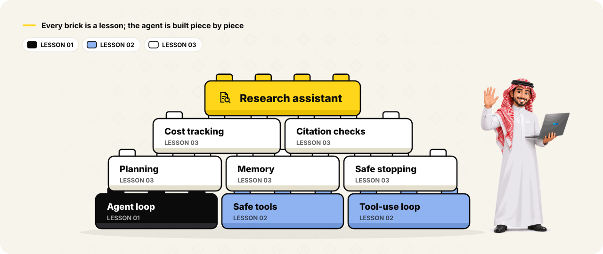
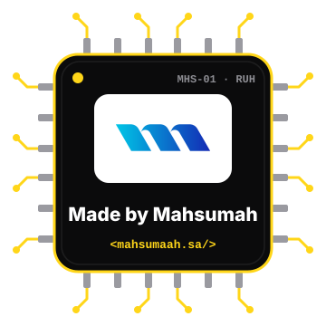
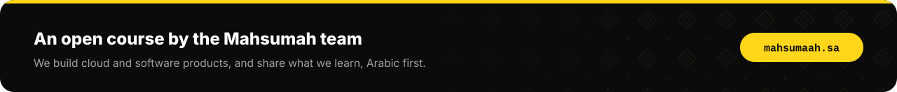

<p align="center"><b>English</b> · <a href="README.md">العربية</a></p>

<p align="center">
  <picture>
    <source media="(prefers-color-scheme: dark)" srcset="assets/banner-en-dark.svg">
    <source media="(prefers-color-scheme: light)" srcset="assets/banner-en-light.svg">
    
  </picture>
</p>

<h1 align="center">AI Agents in Arabic: from zero to production</h1>

<p align="center"></p>

<p align="center"><b>Learn to build AI agents step by step, with runnable code and tests that pass without an API key.</b></p>

<p align="center"><sub>An original course written in Arabic, with a complete English edition of every lesson.</sub></p>

<p align="center">
  
  
  
  
  
</p>

<p align="center">
  <a href="docs/en/00-setup/README.md"></a>
  <a href="#course-map"></a>
</p>

<p align="center"><a href="docs/en/glossary.md">Glossary</a> · <a href="CONTRIBUTING.en.md">Contributing</a></p>

## What makes this course different

There are plenty of agent courses, and almost all of them are in English, built on English text. This one is Arabic-first, built on the problems Arabic itself raises:

<p align="center"></p>

## What you'll build

<p align="center"></p>

In Lesson 03 you run a research assistant that reads a small set of local documents, makes a plan, calls its search and read tools, then answers and cites the file and line behind every claim. You start smaller, in Lesson 01, with an agent loop that needs no model and no API key:

```console
$ python lessons/01/agent_loop_toy.py
step 1: guess= 50 -> higher
step 2: guess= 75 -> lower
step 3: guess= 62 -> higher
step 4: guess= 68 -> higher
step 5: guess= 71 -> higher
step 6: guess= 73 -> correct
solved
```

On the way there, you build by hand:

- **An agent loop with no AI at all**, so you understand the structure before a model enters it.
- **Safe tools from scratch:** a calculator without `eval`, date and time, a sandboxed file reader, and a delete tool that only runs with your approval.
- **The tool-use loop, written by hand**, line by line.
- **A research assistant** that reads local Arabic documents, plans, remembers the conversation, stops safely, tracks its own cost, and has every citation in its answer checked.
- **A complete feature, built spec-first:** a VAT invoice calculator taken through a constitution, a spec, a plan and a task list before any code is written, and a tool that checks the spec and the tasks before building.

## Course map

| | # | Lesson | What you'll learn | Status |
|:---:|:---:|---|---|:---:|
|  | 00 | [Setting up your workspace](docs/en/00-setup/README.md) | Python, keeping your API key safe, cost, and safety rules | **available** |
|  | 01 | [What is an agent?](docs/en/01-what-is-an-agent/README.md) | Model vs. workflow vs. agent, the perceive, think, act loop, when not to build an agent, and your first request | **available** |
|  | 02 | [Tools from scratch](docs/en/02-tools/README.md) | Defining tools with JSON Schema, the hand-written loop, error handling, and guarding dangerous tools | **available** |
|  | 03 | [A first real agent: research assistant](docs/en/03-first-agent/README.md) | Planning, memory, stopping conditions, cost tracking, and citation checks | **available** |
|  | 04 | [Spec-driven development](docs/en/04-spec-driven/README.md) | Constitution, spec, plan, tasks and implementation with a coding agent, a bug-fixing path, and assessing an idea before building it | **available** |
|  | 05 | MCP: build a tool server | Connecting an agent to external tools through an open standard | coming soon |
|  | 06 | Agent skills | Bundles of instructions and resources an agent loads when it needs them | coming soon |
|  | 07 | Long-term memory and retrieval (RAG) | Embeddings, semantic search, and managing long context | coming soon |
|  | 08 | Evaluating agents | Measuring an agent's quality with numbers, not impressions | coming soon |
|  | 09 | Agent security | Permissions, prompt injection, approvals, and logs | coming soon |
|  | 10 | Multi-agent systems | When to split work across several agents, and how | coming soon |
|  | 11 | Deployment and monitoring | Running an agent for real, and watching its cost and errors | coming soon |
|  | 12 | Capstone project | A complete agent, from idea to production | coming soon |

Every lesson has: a clear explanation, diagrams, runnable code, "common mistakes", a "check yourself" quiz, exercises with separate solutions, and key terms collected in the [glossary](docs/en/glossary.md). The original Arabic edition of each lesson is one click away at the top of every page.

## Get started in five minutes

```bash
python3 -m venv .venv && source .venv/bin/activate   # Windows: see docs/00-setup
pip install -r requirements-dev.txt

python -m pytest                          # all lessons, offline, no API key
python lessons/01/agent_loop_toy.py       # the agent loop, no API key

export ANTHROPIC_API_KEY="..."            # never write it in code
python lessons/02/tool_loop.py "What is 15% of 2480?"
python lessons/03/research_agent.py
python lessons/04/spec_check.py lessons/04/example   # read the spec before building
```

The Arabic prompt above asks "what is 15% of 2480?" (written with Arabic-Indic digits, which the calculator tool accepts). Details, the Windows steps, and how cost is calculated are all in [Lesson 00](docs/en/00-setup/README.md).

## Who is this course for?

- **Programmers who know basic Python** and want to understand agents from the inside, rather than copy a ready-made framework.
- **Computer science students** looking for precise explanations of the terminology. The Arabic edition gives each English term once, so moving between Arabic and English references is easy.
- **Team leads** who need to decide when an agent is worth its cost, and when a single request is enough.

You don't need any prior AI experience. You need to be able to write a Python function and run a command in a terminal.

## How to study this course

1. Read the lesson, run the code, then change something and predict the result before you run it again.
2. Answer "check yourself" without opening the answers.
3. Solve the exercises, then compare with the solutions.
4. Run `python -m pytest` after every change.

> [!NOTE]
> **About the examples:** we use the official Anthropic Python library and Claude models. The default model is `claude-opus-5-5`, and you can change it with the `AGENT_MODEL` environment variable. The concepts themselves (the loop, tools, stopping conditions, cost) are general, and you'll find them with any other model provider under slightly different names.

## Repository layout

```text
docs/        lesson texts (Arabic) and the glossary
docs/en/     the full English edition, same structure
lessons/     runnable code for each lesson
solutions/   exercise solutions (try first!)
tests/       offline tests with a fake client
assets/      original diagrams, banners and icons (SVG)
```

## If the course helped you

If you found the course useful, a ⭐ on the repository helps other developers find it, and tells us the next lessons are worth speeding up. That's all we ask, and nothing is offered in return.

## Contributing

Corrections, new exercises and questions are welcome. Please read the [contributing guide](CONTRIBUTING.en.md) and the [code of conduct](CODE_OF_CONDUCT.en.md) before you start.

### Contributors

Contributor avatars will appear here once the repository is public. Be the first to fix a mistake or add an exercise.

<!--
After the repository is public, replace MahsumahCloud/arabic-ai-agents and uncomment:
<a href="https://github.com/MahsumahCloud/arabic-ai-agents/graphs/contributors"></a>
-->

## Original content

Every text, diagram, example and exercise in this course was written from scratch for it. It is not a translation of, or copied from, any other course. The sample documents in `lessons/03/corpus/` were also written for the course. If you see anything that suggests otherwise, please tell us.

## License

- **Code** (`lessons/`, `solutions/`, `tests/`): [MIT](LICENSE).
- **Written content and diagrams**: [CC BY 4.0](LICENSE-content). You may copy, adapt and use them, as long as you credit the source.

## About Mahsumah



This course was prepared by the team at [Mahsumah](https://mahsumaah.sa). We build cloud and software products, and we share what we learn in the open, Arabic first.

<br clear="right">

<p align="center"><a href="https://mahsumaah.sa"></a></p>

---

<p align="center"><sub><a href="DISCLAIMER.en.md">Disclaimer</a> · <a href="NOTICE.en.md">Trademarks</a> · <a href="SECURITY.en.md">Security</a> · <a href="PRIVACY.en.md">Privacy</a> · <a href="LICENSE">License</a></sub></p>
<p align="center"><sub>© Mahsumah · <a href="https://mahsumaah.sa">mahsumaah.sa</a></sub></p>
