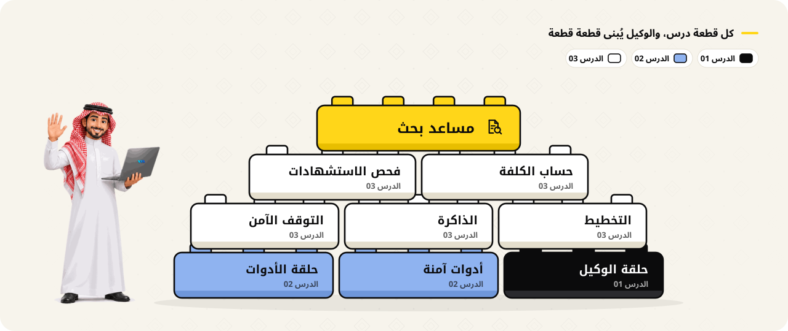
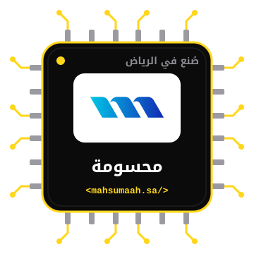

<div dir="rtl">

<p align="center"><b>العربية</b> · <a href="README.en.md">English</a></p>

<p align="center">
  <picture>
    <source media="(prefers-color-scheme: dark)" srcset="assets/banner-ar-dark.svg">
    <source media="(prefers-color-scheme: light)" srcset="assets/banner-ar-light.svg">
    
  </picture>
</p>

<h1 align="center">وكلاء الذكاء الاصطناعي بالعربي: من الصفر إلى الاحتراف</h1>

<p align="center"></p>

<p align="center"><b>تعلّم بناء وكلاء الذكاء الاصطناعي بالعربية، خطوة خطوة، بشيفرة تعمل واختبارات تمر دون مفتاح API.</b></p>

<p align="center">
  
  
  
  
  
</p>

<p align="center">
  <a href="docs/00-setup/README.md"></a>
  <a href="#خريطة-الدورة"></a>
</p>

<p align="center"><a href="docs/glossary.md">المسرد</a> · <a href="CONTRIBUTING.md">ساهم معنا</a></p>

## ما الذي يميّز هذه الدورة؟

دورات الوكلاء كثيرة، وأغلبها بالإنجليزية وعلى نصوص إنجليزية. هذه الدورة كُتبت بالعربية أولاً، وعلى مشكلات العربية نفسها:

<p align="center"></p>

## ماذا ستبني؟

<p align="center"></p>

في الدرس 03 تشغّل «مساعد بحث» يقرأ مستندات عربية محلية، ويضع خطة، ويستدعي أدوات البحث والقراءة، ثم يجيب ويذكر مصدر كل معلومة:

</div>
<div dir="ltr">

```console
$ python lessons/03/research_agent.py
Research assistant. Documents:
calligraphy.txt (9 lines): الخط العربي: فنّ الحرف
hijri.txt (8 lines): التقويم الهجري
palm.txt (9 lines): النخلة: شجرة الصحراء الكريمة
solar.txt (8 lines): الطاقة الشمسية: أساسيات
Ask in Arabic. Empty line to quit.

> ما مراحل ثمرة النخلة؟
plan: ابحث عن مراحل الثمرة / اقرأ الأسطر / أجب مع المصادر
تمرّ ثمرة النخلة بمراحل متتابعة، أشهرها في الخليج: الخلال ثم الرطب ثم التمر [palm.txt:5].
[stop: done | steps: 4 | citations: valid 1 | this question: $0.0xxx]
[session: 4 calls | in ... | out ... | cache w/r 0/0 | $0.0xxx]
```

</div>
<div dir="rtl">

<sub>شكل المخرجات للتوضيح فقط، وليس نتيجة تشغيل فعلية؛ النص والأرقام ستختلف عندك.</sub>

وفي الطريق إليه تبني بيدك:

- **حلقة وكيل بلا ذكاء اصطناعي** لتفهم البنية قبل أن يدخلها النموذج.
- **أدوات آمنة من الصفر:** حاسبة بلا `eval`، وتاريخ ووقت، وقارئ ملفات في صندوق رمل، وحذف لا يتم إلا بموافقتك.
- **حلقة استخدام الأدوات مكتوبة يدوياً** سطراً سطراً.
- **«مساعد بحث»** يقرأ مستندات عربية محلية، ويخطط، ويتذكر المحادثة، ويتوقف بأمان، ويحسب كلفته، ويُتحقَّق من كل استشهاد في إجابته.

## خريطة الدورة

| | # | الدرس | ما ستتعلمه | الحالة |
|:---:|:---:|---|---|:---:|
|  | 00 | [تجهيز بيئة العمل](docs/00-setup/README.md) | Python، ومفتاح API بأمان، والكلفة، وقواعد السلامة | **متاح** |
|  | 01 | [ما هو الوكيل؟](docs/01-what-is-an-agent/README.md) | الفرق بين النموذج وسير العمل والوكيل، وحلقة الإدراك والتفكير والفعل، ومتى لا تبني وكيلاً، وأول طلب | **متاح** |
|  | 02 | [الأدوات من الصفر](docs/02-tools/README.md) | تعريف الأدوات بمخطط JSON، والحلقة اليدوية، ومعالجة الأخطاء، وحراسة الأدوات الخطرة | **متاح** |
|  | 03 | [أول وكيل حقيقي: «مساعد بحث»](docs/03-first-agent/README.md) | التخطيط، والذاكرة، وشروط التوقف، وحساب الكلفة، وفحص الاستشهادات | **متاح** |
|  | 04 | بروتوكول MCP: ابنِ خادم أدوات | ربط الوكيل بأدوات خارجية بمعيار مفتوح | قريباً |
|  | 05 | المهارات | حزم تعليمات وموارد يحمّلها الوكيل عند الحاجة | قريباً |
|  | 06 | الذاكرة الطويلة والاسترجاع (RAG) | التضمينات، والبحث الدلالي، وإدارة السياق الطويل | قريباً |
|  | 07 | تقييم الوكلاء | كيف تقيس جودة الوكيل بأرقام لا بانطباعات | قريباً |
|  | 08 | أمان الوكلاء | الصلاحيات، وحقن التعليمات، والموافقات، والسجلات | قريباً |
|  | 09 | أنظمة الوكلاء المتعددين | متى تقسم العمل بين عدة وكلاء، وكيف | قريباً |
|  | 10 | النشر والمراقبة | تشغيل الوكيل في بيئة حقيقية، ومراقبة الكلفة والأخطاء | قريباً |
|  | 11 | مشروع التخرّج | وكيل متكامل من الفكرة إلى التشغيل | قريباً |

كل درس فيه: شرح بالعربية الفصحى، ورسوم توضيحية، وشيفرة قابلة للتشغيل، و«أخطاء شائعة»، و«اختبر نفسك»، وتمارين بحلول منفصلة، ومصطلحات تُجمع في [المسرد](docs/glossary.md). وكل درس له نسخة إنجليزية كاملة.

## ابدأ في خمس دقائق

</div>
<div dir="ltr">

```bash
python3 -m venv .venv && source .venv/bin/activate   # Windows: see docs/00-setup
pip install -r requirements-dev.txt

python -m pytest                          # all lessons, offline, no API key
python lessons/01/agent_loop_toy.py       # the agent loop, no API key

export ANTHROPIC_API_KEY="..."            # never write it in code
python lessons/02/tool_loop.py "كم يساوي ١٥٪ من ٢٤٨٠؟"
python lessons/03/research_agent.py
```

</div>
<div dir="rtl">

التفاصيل، وطريقة Windows، وحساب الكلفة، كلها في [الدرس 00](docs/00-setup/README.md).

## لمن هذه الدورة؟

- **للمبرمج الذي يعرف أساسيات Python** ويريد أن يفهم الوكلاء من الداخل، لا أن ينسخ إطار عمل جاهزاً.
- **لطالب الحاسب** الذي يبحث عن شرح عربي دقيق للمصطلحات، مع ذكر المصطلح الإنجليزي ليسهل عليه الرجوع إلى المراجع.
- **لقائد الفريق** الذي يريد أن يقرّر متى يستحق الوكيل كلفته، ومتى يكفي طلب واحد.

لا تحتاج خبرة سابقة في الذكاء الاصطناعي. تحتاج أن تكتب دالة في Python وتشغّل أمراً في الطرفية.

## كيف تدرس هذه الدورة؟

1. اقرأ الدرس، وشغّل الشيفرة، ثم غيّر فيها شيئاً وتوقّع النتيجة قبل التشغيل.
2. أجب عن «اختبر نفسك» دون أن تفتح الإجابات.
3. حلّ التمارين، ثم قارن بالحلول.
4. شغّل `python -m pytest` بعد كل تعديل.

> [!NOTE]
> **عن الأمثلة:** نستعمل مكتبة Anthropic الرسمية للغة Python ونماذج Claude، والنموذج الافتراضي `claude-opus-5-5`، ويمكن تغييره بمتغير البيئة `AGENT_MODEL`. المفاهيم نفسها (الحلقة، والأدوات، وشروط التوقف، والكلفة) عامة، وستجدها عند أي مزوّد نماذج آخر بأسماء مختلفة.

## بنية المستودع

| المجلد | ما فيه |
|---|---|
| `docs/` | نصوص الدروس بالعربية، والمسرد |
| `docs/en/` | النسخة الإنجليزية الكاملة بالبنية نفسها |
| `lessons/` | شيفرة كل درس، جاهزة للتشغيل |
| `solutions/` | حلول التمارين (حاول أولاً!) |
| `tests/` | اختبارات تعمل دون اتصال بعميل وهمي |
| `assets/` | الرسوم والبانر والأيقونات الأصلية (SVG) |

## إن نفعتك الدورة

إن وجدت في الدورة فائدة، فنجمة ⭐ على المستودع تساعد مبرمجين آخرين على الوصول إليها، وتخبرنا أن الدروس القادمة تستحق الإسراع. لا نطلب أكثر من ذلك، ولا نعد بشيء في مقابله.

## ساهم معنا

التصحيحات والتمارين الجديدة والأسئلة مرحّب بها. اقرأ [دليل المساهمة](CONTRIBUTING.md) و[ميثاق السلوك](CODE_OF_CONDUCT.md) قبل أن تبدأ.

### المساهمون

ستظهر هنا صور المساهمين بعد نشر المستودع. كن أول من يصحّح خطأً أو يضيف تمريناً.

<!--
بعد أن يصبح المستودع عاماً، أزل علامة التعليق عن السطر التالي:
<a href="https://github.com/MahsumahCloud/arabic-ai-agents/graphs/contributors"></a>
-->

## أصالة المحتوى

كل نصوص هذه الدورة ورسومها وأمثلتها وتمارينها كُتبت من الصفر لهذه الدورة. ليست ترجمة لأي دورة أخرى ولا نقلاً منها. المستندات التجريبية في `lessons/03/corpus/` كُتبت أيضاً للدورة. إذا رأيت ما يخالف ذلك فأبلغنا.

## الترخيص

- **الشيفرة** (`lessons/` و`solutions/` و`tests/`): رخصة [MIT](LICENSE).
- **المحتوى المكتوب والرسوم**: رخصة [CC BY 4.0](LICENSE-content). يمكنك النسخ والتعديل والاستعمال بشرط ذكر المصدر.

## عن محسومة



أعدّ هذه الدورة فريق [محسومة](https://mahsumaah.sa). نبني منتجات سحابية وبرمجية، ونشارك ما نتعلّمه مفتوحاً، بالعربية أولاً.

<br clear="left">

<p align="center"><a href="https://mahsumaah.sa"></a></p>

---

<p align="center"><sub><a href="DISCLAIMER.md">إخلاء المسؤولية</a> · <a href="NOTICE.md">العلامات التجارية</a> · <a href="SECURITY.md">الأمان</a> · <a href="PRIVACY.md">الخصوصية</a> · <a href="LICENSE">الترخيص</a></sub></p>
<p align="center"><sub>© محسومة · <a href="https://mahsumaah.sa">mahsumaah.sa</a></sub></p>

</div>
