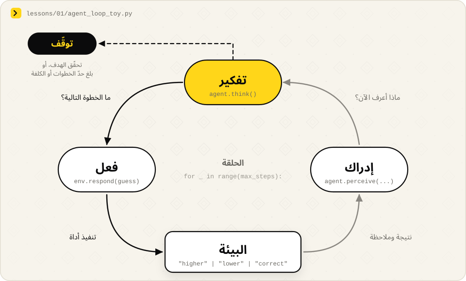

<div dir="rtl">

<p align="center"><a href="../en/01-what-is-an-agent/README.md">English</a> · <b>العربية</b></p>

<p align="center"></p>

# الدرس 01: ما هو الوكيل؟

> [!NOTE]
> **ستتعلم في هذا الدرس**
>
> - أن تفرّق بدقة بين النموذج اللغوي الكبير وسير العمل والوكيل.
> - أن تفهم حلقة «إدراك ثم تفكير ثم فعل» وشرط التوقف.
> - أن تعرف متى **لا** تبني وكيلاً.
> - أن ترسل أول طلب إلى النموذج وتقرأ ردّه قراءة صحيحة.
>
> **المدة المتوقعة:** 45 دقيقة · **ستبني:** حلقة وكيل بسيطة بلا ذكاء اصطناعي، ثم أول طلب حقيقي إلى نموذج لغوي. · **الشيفرة:** [`lessons/01/`](../../lessons/01/)

## شغّل الدرس

</div>
<div dir="ltr">

```console
$ python lessons/01/agent_loop_toy.py       # no API key needed
$ python lessons/01/first_call.py "ما الفرق بين النموذج اللغوي والوكيل؟"   # needs ANTHROPIC_API_KEY
```

</div>
<div dir="rtl">

## 1. النموذج اللغوي الكبير: دالة نصّ إلى نصّ

النموذج اللغوي الكبير (Large Language Model, LLM) برنامج تدرّب على كمّ هائل من النصوص، فصار قادراً على توليد نص مناسب لما يُعطى له. من زاوية المبرمج هو دالة: ترسل له رسائل، فيعيد رداً.

ثلاث خصائص تحكم كل ما سنبنيه:

1. **لا يملك ذاكرة بين الطلبات.** كل طلب مستقل. إذا أردته أن «يتذكر» فعليك أنت أن ترسل له المحادثة السابقة.
2. **لا يفعل شيئاً في العالم.** يكتب نصاً فقط. لا يقرأ ملفاتك ولا يرسل بريداً، إلا إذا كتبت أنت شيفرة تفعل ذلك نيابة عنه.
3. **معرفته محدودة** بما تدرّب عليه وبما ترسله له في الطلب.

## 2. ثلاث درجات: طلب واحد، سير عمل، وكيل

| الدرجة | من يقرّر الخطوة التالية؟ | مثال |
|---|---|---|
| طلب واحد (Single Call) | لا توجد خطوة تالية | «لخّص هذه الفقرة» |
| سير عمل (Workflow) | **شيفرتك** تحدد الخطوات مسبقاً | ترجم النص، ثم صحّح إملاءه، ثم استخرج العناوين |
| وكيل (Agent) | **النموذج** يقرّر في كل خطوة ماذا يفعل | «ابحث في هذه المستندات وأجبني مع المصادر» |

**التعريف الذي نعتمده في الدورة:** الوكيل نظام يستعمل نموذجاً لغوياً ليقرّر خطواته بنفسه داخل حلقة: يختار أداة، وتنفّذها شيفرتك، ويرى النتيجة، ثم يقرّر من جديد، إلى أن يتحقق الهدف أو يُبلَغ حدٌّ للتوقف.

> [!IMPORTANT]
> **باختصار:** وكيل = نموذج + أدوات + حلقة + شرط توقف. إذا غاب واحد منها فليس وكيلاً.

## 3. الحلقة: إدراك ثم تفكير ثم فعل

<p align="center"></p>

- **الإدراك (Perceive):** ما يعرفه الوكيل الآن: طلب المستخدم، ونتائج الأدوات السابقة.
- **التفكير (Think):** اختيار الخطوة التالية. في الوكيل الحقيقي هذا هو دور النموذج.
- **الفعل (Act):** تنفيذ الخطوة في البيئة، كقراءة ملف أو إجراء عملية حسابية.
- **البيئة (Environment):** العالم الذي يتأثر بالفعل ويعيد نتيجة.
- **التوقف:** كل حلقة تحتاج مخرجاً واضحاً: تحقّق الهدف، أو بلوغ حدّ الخطوات أو الكلفة.

> [!WARNING]
> **انتبه:** الحلقة بلا شرط توقف خطأ برمجي ينتظر وقته.

### الحلقة بلا ذكاء اصطناعي

قبل أن ندخل النموذج، لنرَ الحلقة عارية. في [`agent_loop_toy.py`](../../lessons/01/agent_loop_toy.py) رقم سري مخفي في «البيئة»، والوكيل لا يراه. يستطيع أن يخمّن (فعل)، ويقرأ الرد «أكبر» أو «أصغر» أو «صحيح» (إدراك)، ويقرّر التخمين التالي بالبحث الثنائي (تفكير):

</div>
<div dir="ltr">

```python
def run(env, max_steps=10):
    agent = GuessingAgent(low=env.low, high=env.high)
    for _ in range(max_steps):              # guard: a hard step limit
        guess = agent.think()               # think
        feedback = env.respond(guess)       # act; the world reacts
        agent.perceive(guess, feedback)     # perceive (and remember)
        if feedback == "correct":           # stop: goal reached
            return True, agent.history
    return False, agent.history             # stop: limit reached
```

</div>
<div dir="rtl">

شغّله:

</div>
<div dir="ltr">

```bash
python lessons/01/agent_loop_toy.py
```

</div>
<div dir="rtl">

> [!TIP]
> **الفكرة الأهم في الدرس:** لاحظ أن «الدماغ» هنا شيفرة ثابتة. في الدرس 02 نستبدل به نموذجاً لغوياً، وتبقى الحلقة بالشكل نفسه. **الوكيل حلقة تكتبها أنت، والنموذج هو الجزء الذي يقرّر داخلها.**

## 4. متى لا تبني وكيلاً؟

الوكيل أبطأ وأغلى وأصعب في الاختبار من طلب واحد. قبل أن تبنيه اسأل أربعة أسئلة، فإذا كان جواب أي منها «لا» فاختر درجة أبسط:

1. **التعقيد:** هل المهمة متعددة الخطوات ويصعب تحديد خطواتها مسبقاً؟
2. **القيمة:** هل تستحق النتيجة الكلفة والوقت الإضافيين؟
3. **القدرة:** هل النموذج قادر فعلاً على هذا النوع من المهام؟
4. **كلفة الخطأ:** هل يمكن اكتشاف الخطأ وإصلاحه (اختبارات، مراجعة، تراجع)؟

| المهمة | الاختيار المناسب | السبب |
|---|---|---|
| تصنيف رسالة إلى «شكوى» أو «استفسار» | طلب واحد | خطوة واحدة معروفة |
| تحويل فاتورة إلى بيانات ثم حفظها ثم إرسال إشعار | سير عمل | الخطوات ثابتة ومعروفة |
| الإجابة عن سؤال من مئات المستندات مع ذكر المصادر | وكيل | لا تُعرف مسبقاً المستندات التي يلزم البحث فيها |
| تنفيذ تحويلات مالية تلقائياً | لا وكيل دون موافقة بشرية | كلفة الخطأ عالية ولا تُستدرك |

## 5. أول طلب حقيقي إلى النموذج

الآن نرسل طلباً واحداً، ليس وكيلاً بعد، لكنه اللبنة التي يُبنى منها كل وكيل. الملف [`first_call.py`](../../lessons/01/first_call.py):

</div>
<div dir="ltr">

```python
import anthropic

client = anthropic.Anthropic()  # reads ANTHROPIC_API_KEY from the environment

response = client.messages.create(
    model="claude-opus-5-5",
    max_tokens=16000,                    # a ceiling, not a target
    output_config={"effort": "low"},     # low | medium | high | xhigh | max
    system="أنت مساعد تعليمي. أجب بالعربية الفصحى في ثلاث جمل على الأكثر.",
    messages=[{"role": "user", "content": "ما الفرق بين النموذج اللغوي والوكيل؟"}],
)

if response.stop_reason == "refusal":
    print("the model declined")
else:
    print("".join(b.text for b in response.content if b.type == "text"))
print(response.usage.input_tokens, response.usage.output_tokens)
```

</div>
<div dir="rtl">

شغّله (يحتاج مفتاحاً):

</div>
<div dir="ltr">

```bash
python lessons/01/first_call.py "ما الفرق بين النموذج اللغوي والوكيل؟"
```

</div>
<div dir="rtl">

### حقول الطلب

| الحقل | معناه |
|---|---|
| `model` | معرّف النموذج. نجعله قابلاً للتغيير عبر `AGENT_MODEL`. |
| `max_tokens` | أقصى عدد رموز يُسمح للرد بإنتاجه. حدّ أعلى لا هدف، وتدفع فقط ما يُنتَج فعلاً. |
| `system` | تعليمات النظام (System Prompt): الدور والقواعد العامة. |
| `messages` | المحادثة: قائمة رسائل، لكل منها `role` (`user` أو `assistant`) و`content`. أول رسالة دائماً من `user`. |
| `output_config.effort` | مستوى الجهد: كم يفكّر النموذج وكم يستهلك. |

### حقول الرد

| الحقل | معناه |
|---|---|
| `content` | **قائمة** كتل محتوى (Content Blocks)، لا نص واحد. قد تكون من أنواع `text` و`thinking` و`tool_use`. |
| `stop_reason` | سبب توقف النموذج: `end_turn` (أنهى)، `max_tokens` (انقطع)، `tool_use` (يطلب أداة)، `refusal` (رفض). |
| `usage` | عدد رموز الإدخال والإخراج، وهو أساس حساب الكلفة. |

### ملاحظة عن التفكير في Claude Opus 5.5

النموذج `claude-opus-5-5` يفكّر دائماً بطريقة تكيّفية (Adaptive Thinking) قبل أن يجيب، ولا يمكن إيقاف التفكير فيه؛ إرسال `thinking: {"type": "disabled"}` يعيد خطأ 400. الذي تتحكم فيه هو **مستوى الجهد**، وقيمته الافتراضية في هذا النموذج `medium`.

> [!WARNING]
> **تنبيه:** قد يحتوي الرد على كتلة من نوع `thinking` قبل كتلة النص، ولهذا لا نقرأ `content[0].text` مباشرة أبداً، بل نصفّي الكتل حسب نوعها.

### لكل مزوّد أسماؤه، والمفاهيم واحدة

نستعمل في الأمثلة مكتبة Anthropic الرسمية، لكن المفاهيم في هذا الدرس عامة: رسائل بأدوار، وتعليمات نظام، وسبب توقف، وعدّاد رموز. ستجدها كلها عند أي مزوّد نماذج آخر بأسماء مختلفة قليلاً.

## أخطاء شائعة

| الخطأ | لماذا هو خطأ | الصواب |
|---|---|---|
| قراءة `response.content[0].text` مباشرة | أول كتلة قد تكون `thinking` لا `text` | صفِّ الكتل حسب `block.type` |
| تجاهل `stop_reason` | قد يكون الرد مقطوعاً (`max_tokens`) أو مرفوضاً (`refusal`) | افحصه قبل الوثوق بالمحتوى |
| افتراض أن النموذج يتذكر السؤال السابق | الواجهة لا تحفظ حالة بين الطلبات | أرسل المحادثة كاملة في `messages` |
| بناء وكيل لمهمة من خطوة واحدة | كلفة وبطء وتعقيد بلا فائدة | ابدأ بأبسط درجة تكفي |
| حلقة بلا حدّ للخطوات | قد تدور بلا نهاية وتستهلك رصيدك | ضع `max_steps` في كل حلقة |

## اختبر نفسك

1. ما العناصر الأربعة التي لا يكون الوكيل وكيلاً بدونها؟
2. ما الفرق بين سير العمل والوكيل من حيث من يقرّر الخطوة التالية؟
3. لماذا لا نقرأ `response.content[0].text` مباشرة مع Opus 5.5؟
4. اذكر شرطَي توقف استعملناهما في `agent_loop_toy.py`.
5. مهمة: «استخرج تاريخ الفاتورة من نص قصير». هل تبني لها وكيلاً؟ ولماذا؟

<details>
<summary><b>الإجابات</b></summary>

1. نموذج، وأدوات، وحلقة، وشرط توقف.
2. في سير العمل تحدد شيفرتك الخطوات مسبقاً، وفي الوكيل يقرّرها النموذج في كل دورة.
3. لأن المحتوى قائمة كتل، وقد تأتي كتلة `thinking` أولاً.
4. تحقّق الهدف (`"correct"`)، وبلوغ حدّ الخطوات (`max_steps`). وهناك ثالث احتياطي: حالة مستحيلة (`low > high`).
5. لا. خطوة واحدة معروفة، يكفيها طلب واحد.

</details>

## تمارين

1. **الحدّ الأدنى للخطوات:** غيّر نطاق الرقم السري إلى 1 حتى 1000. ما أقل قيمة لـ `max_steps` تضمن أن يجد الوكيل أي رقم؟ احسبها نظرياً ثم تحقّق منها بالشيفرة.
2. **إجابة موجزة:** اكتب دالة `ask_brief(client, question)` تعيد زوجاً `(النص, سبب التوقف)`، وتطلب من النموذج الإجابة في جملتين أو ثلاث، وتصرّح بعدم اليقين إن وُجد.
3. **صنّف المهام:** لكل مهمة مما يلي اختر «طلب واحد» أو «سير عمل» أو «وكيل» وعلّل: (أ) ترجمة تغريدة. (ب) فحص مستودع شيفرة لإيجاد سبب خطأ غير معروف. (ج) إنشاء تقرير أسبوعي ثابت الأقسام من قاعدة بيانات. (د) الرد على أسئلة العملاء من دليل استخدام طويل مع ذكر الصفحة.

الحلول في [`solutions/01/`](../../solutions/01/).

## مصطلحات الدرس

النموذج اللغوي الكبير (Large Language Model) · الوكيل (Agent) · سير العمل (Workflow) · الحلقة (Loop) · الإدراك (Perceive) · التفكير (Think) · الفعل (Act) · البيئة (Environment) · شرط التوقف (Stopping Condition) · تعليمات النظام (System Prompt) · كتلة المحتوى (Content Block) · سبب التوقف (Stop Reason) · التفكير التكيّفي (Adaptive Thinking)

التعريفات الكاملة في [المسرد](../glossary.md).

---

<p align="center"><b>السابق:</b> <a href="../00-setup/README.md">الدرس 00: تجهيز بيئة العمل</a> · <a href="../../README.md#خريطة-الدورة">خريطة الدورة</a> · <b>التالي:</b> <a href="../02-tools/README.md">الدرس 02: الأدوات من الصفر</a></p>

</div>
