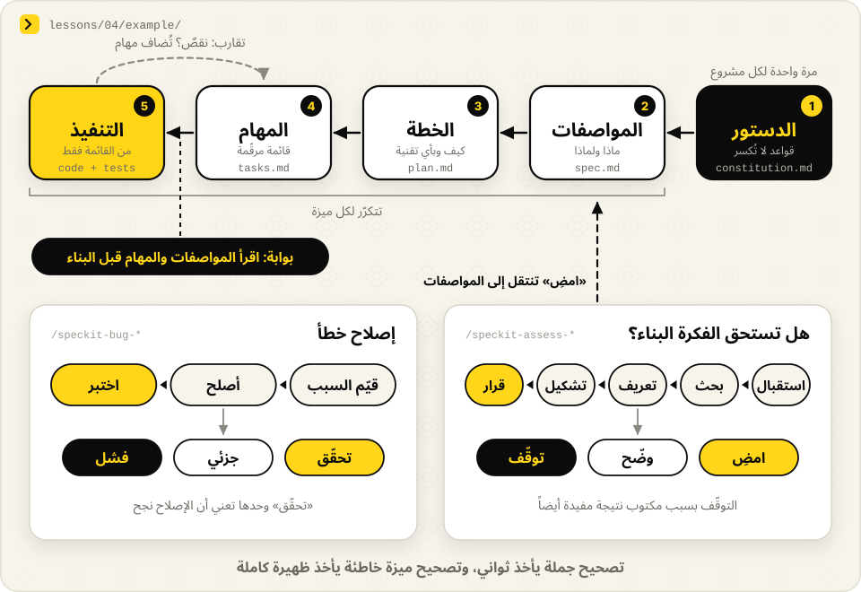

<div dir="rtl">

<p align="center"><a href="../en/04-spec-driven/README.md">English</a> · <b>العربية</b></p>

<p align="center"></p>

<p align="center"></p>

# الدرس 04: التطوير الموجّه بالمواصفات (Spec-Driven Development)

> [!NOTE]
> **ستتعلم في هذا الدرس**
>
> - لماذا يخطئ وكيل البرمجة حين تعطيه فكرة في سطر واحد، وكيف تمنع ذلك قبل أن يكتب سطراً من الشيفرة.
> - الخطوات الخمس: الدستور، ثم المواصفات، ثم الخطة، ثم المهام، ثم التنفيذ.
> - العادة الأهم: أن تقرأ المواصفات وقائمة المهام بنفسك قبل أن تسمح للوكيل بالبناء.
> - مساراً قصيراً لإصلاح الأخطاء، وطريقة لتقرّر هل تستحق الفكرة البناء أصلاً.
> - كيف تطبّق ذلك كله بأداة Spec Kit المفتوحة المصدر مع وكيل مثل Claude Code.
>
> **المدة المتوقعة:** 60 دقيقة · **ستبني:** حاسبة فاتورة بضريبة القيمة المضافة تقبل الأرقام العربية، تمرّ بالخطوات الخمس بملفات حقيقية، وأداة صغيرة تفحص المواصفات والمهام قبل البناء. · **الشيفرة:** [`lessons/04/`](../../lessons/04/)

## شغّل الدرس


</div>
<div dir="ltr">

```console
$ python -m pytest tests/test_lesson04.py                    # offline, no API key
$ python lessons/04/spec_check.py lessons/04/example         # read the spec before building
$ python lessons/04/vat_invoice.py "قهوة=١٥" "كعكة=٢٢٫٥"     # the feature built from it
```

</div>
<div dir="rtl">

لا يحتاج هذا الدرس مفتاح API: الشيفرة كلها تعمل دون اتصال.

## 1. لماذا لا يكفي «اكتب لي ميزة»؟

وكيل البرمجة مثل Claude Code ينفّذ ما يفهمه من طلبك، وما لم تقله يملؤه بتخمين معقول في نظره. اطلب «حاسبة فاتورة بالضريبة» وسيقرّر عنك عشرات الأشياء دون أن يسألك: هل تُحسب الضريبة على كل بند أم على المجموع؟ كيف يُقرَّب المبلغ؟ هل يقبل «١٥» بالأرقام العربية؟ ماذا يفعل بالمبلغ السالب؟

كل قرار من هذه قد يكون صحيحاً، وقد لا يكون. والمشكلة أنك لا ترى القرار إلا بعد أن يصبح شيفرة، ثم اختبارات، ثم ربما عادة في عمل فريقك.

التطوير الموجّه بالمواصفات يقلب الترتيب: **تُكتب القرارات أولاً بلغة واضحة، ويقرؤها إنسان، ثم تُبنى الشيفرة منها.** ليست الفكرة جديدة على هذه الدورة: في الدرس 03 جعلنا الوكيل يكتب خطته في أداة `write_plan` حتى «تُفحص» قبل التنفيذ. هنا نطبّق المبدأ نفسه على مشروع كامل.

## 2. الخطوات الخمس

<p align="center"></p>

<p align="center"></p>

| الخطوة | السؤال الذي تجيب عنه | الملف | متى تُكتب |
|:---:|---|---|---|
| 1 | ما القواعد التي لا تُكسر في هذا المشروع؟ | [`constitution.md`](../../lessons/04/example/constitution.md) | مرة واحدة لكل مشروع |
| 2 | ماذا نبني، ولمن، ولماذا؟ | [`spec.md`](../../lessons/04/example/spec.md) | لكل ميزة |
| 3 | كيف سنبنيه، وبأي تقنية؟ | [`plan.md`](../../lessons/04/example/plan.md) | لكل ميزة |
| 4 | ما الخطوات الصغيرة المرتّبة؟ | [`tasks.md`](../../lessons/04/example/tasks.md) | لكل ميزة |
| 5 | الشيفرة والاختبارات | [`vat_invoice.py`](../../lessons/04/vat_invoice.py) | لكل ميزة، من القائمة فقط |

الوكيل يستطيع أن يكتب مسودة كل ملف من هذه الملفات. أنت من يقرأ ويصحّح ويوافق قبل الانتقال إلى الخطوة التالية.

## 3. الخطوة الأولى: الدستور

الدستور ملف قصير بقواعد المشروع العامة، يقرؤه الوكيل قبل كل ميزة. يجيب عن ثلاثة أسئلة: ما معايير الجودة؟ ما شروط الاختبار؟ وما الذي **لا يُلمس**؟ من دستور مثالنا:

> 1. **الدقة المالية أولاً.** كل مبلغ يُحسب بالنوع `Decimal`، ولا يُستعمل `float` في المال أبداً.
>
> **ما لا يُلمس:** ملف المتطلبات `requirements.txt`: لا مكتبات جديدة، فالمكتبة القياسية تكفي.

لاحظ أن كل قاعدة **قابلة للفحص**. «اكتب شيفرة نظيفة» لا يفحصها أحد. «لا `float` في المال» يفحصها اختبار من سطر واحد، وهو موجود فعلاً في `tests/test_lesson04.py`.

> [!TIP]
> قسم «ما لا يُلمس» أثمن ما في الدستور. الوكيل المتحمّس قد «يحسّن» ملفاً لم تطلب تغييره، أو يضيف مكتبة ليوفّر عشرة أسطر. سطر واحد في الدستور يمنع ذلك في كل ميزة قادمة.

## 4. الخطوة الثانية: المواصفات

المواصفات تصف **ماذا ولماذا فقط**. لا لغة برمجة فيها ولا أسماء ملفات، فتلك مكانها الخطة. تبدأ بالفكرة كما قالها صاحبها، ثم تتحوّل إلى أجزاء يمكن فحصها:

| الجزء | مثال من [`spec.md`](../../lessons/04/example/spec.md) |
|---|---|
| المستخدم وقصته | صاحب مقهى يكتب البنود وأسعارها، ويريد المجموع والضريبة والإجمالي |
| متطلبات مرقّمة | م-2: تُحسب الضريبة بنسبة 15٪ مرة واحدة على مجموع البنود، لا على كل بند منفرداً |
| سيناريوهات قبول | بافتراض قهوة بـ ١٥ وكعكة بـ ٢٢٫٥، عندما تُحسب الفاتورة، فإن الإجمالي 43.13 |
| خارج النطاق | الخصومات، والعملات الأخرى، وطباعة الفاتورة |
| أسئلة حُسمت | هل الفاصلة «,» عشرية؟ حُسم: لا، هي فاصل آلاف فقط |

ثلاث قواعد تجعل المواصفات مفيدة للوكيل:

1. **رقّم كل متطلب** (م-1، م-2...). الرقم هو الخيط الذي يربط المتطلب بالمهمة ثم بالاختبار.
2. **اكتب سيناريو قبول بأرقام حقيقية.** «تُحسب الضريبة بدقة» جملة لا تُختبر. «37.50 تعطي ضريبة 5.63» تُختبر.
3. **لا تخفِ ما لا تعرفه.** كل نقطة غامضة تُكتب بالعلامة «[يحتاج توضيحاً]»، ولا يبدأ التنفيذ وفي المواصفات علامة واحدة منها.

## 5. الخطوة الثالثة: الخطة

الآن فقط تدخل التقنية: اللغة، والمكتبات، والملفات، والقرارات التصميمية. كل قرار في [`plan.md`](../../lessons/04/example/plan.md) يذكر المتطلب الذي يخدمه:

| القرار | يخدم |
|---|---|
| الضريبة تُحسب على المجموع بعد تقريبه | م-2، م-3 |
| في فصل الضريبة من السعر الشامل: الصافي يُقرَّب، والضريبة = الإجمالي − الصافي | م-4 |

القرار الثاني مثال جيد على قيمة الخطة. لو قرّبنا الصافي والضريبة كلاً على حدة، لخرج مجموعهما أحياناً مختلفاً عن السعر الأصلي بهللة. هذا خطأ يصعب أن تلاحظه في مراجعة الشيفرة، ويسهل جداً أن تلاحظه في سطر واحد من الخطة.

## 6. الخطوة الرابعة: المهام

المهام قائمة مرتّبة من خطوات صغيرة، كل خطوة تشير إلى متطلب أو أكثر:

</div>
<div dir="ltr">

```text
- [x] ت-5 (م-2، م-3): حساب المجموع ثم الضريبة على المجموع ثم الإجمالي، واختبار سيناريو القهوة والكعكة.
- [x] ت-7 (م-4): دالة الفصل، واختبار أن الصافي والضريبة يساويان الأصل بالهللة لأسعار من 0.01 إلى 1000.
```

</div>
<div dir="rtl">

المهمة الجيدة صغيرة بما يكفي لتُراجع وحدها، وتذكر ما يثبت إنجازها (غالباً اختباراً). والترتيب مهم: التجهيز، ثم الأساس الذي تحتاجه كل القصص، ثم قصة بعد قصة، ثم الإنهاء.

## 7. الخطوة الخامسة: التنفيذ

يبني الوكيل **من القائمة فقط**: مهمة، ثم اختبارها، ثم علامة ✓ عليها، ثم التالية. إذا احتاج شيئاً ليس في القائمة، فهذا يعني أن المواصفات أو الخطة ناقصة، والصواب أن يتوقف ويُعدَّل الملف المعني، لا أن يرتجل.

بعد التنفيذ تأتي خطوة **التقارب** (Convergence): مقارنة الشيفرة بالمواصفات والخطة والمهام. إن وُجد نقص، تُضاف له مهام جديدة إلى القائمة، ثم يُنفَّذ، ثم يُقارن من جديد، حتى لا يبقى نقص.

في مثالنا، كل دالة في [`vat_invoice.py`](../../lessons/04/vat_invoice.py) تذكر رقم المتطلب الذي تخدمه، وكل اختبار في `tests/test_lesson04.py` يبدأ اسمه برقم المتطلب. هكذا تستطيع أن تتبع أي سطر من الشيفرة إلى سبب وجوده.

## 8. العادة الأهم: اقرأ قبل أن تبني

> [!IMPORTANT]
> **تصحيح جملة في المواصفات يأخذ ثواني، وتصحيح ميزة بُنيت خطأً يأخذ ظهيرة كاملة.** لذلك فالبوابة بين «المهام» و«التنفيذ» في الرسم ليست شكلية: لا تسمح للوكيل بالبناء قبل أن تقرأ المواصفات وقائمة المهام بنفسك.

ما الذي تبحث عنه وأنت تقرأ؟

1. هل يقول كل متطلب شيئاً واحداً يمكن اختباره؟
2. هل لكل متطلب مهمة واحدة على الأقل؟ وهل لكل مهمة متطلب؟
3. هل بقيت علامة «[يحتاج توضيحاً]»؟
4. هل في المواصفات كلمات مثل «سريع» و«سهل» و«مناسب» لا تعني شيئاً محدداً؟
5. هل تخالف الخطة شيئاً في الدستور؟

الأسئلة الثلاثة الأولى آلية، فكتبنا لها أداة صغيرة في [`spec_check.py`](../../lessons/04/spec_check.py):

</div>
<div dir="ltr">

```console
$ python lessons/04/spec_check.py lessons/04/example
requirements: 6 | tasks: 8
ready to build: yes | done: yes
```

</div>
<div dir="rtl">

ولو حذفت المهمة ت-7 من القائمة، لأخبرتك الأداة أن المتطلب م-4 بلا مهمة، وأن الميزة ليست جاهزة للبناء. السؤال الرابع موضوع التمرين الثاني. أما الخامس فيبقى لك: الأداة تكشف الفجوات السهلة، والحكم على جودة المتطلب نفسه عمل إنسان.

## 9. مسار إصلاح الأخطاء

ليس كل عمل ميزة جديدة. حين يظهر خطأ، فالمسار أقصر، وثلاث خطوات تكفي:

| الخطوة | ماذا يحدث | ما يُكتب |
|---|---|---|
| قيّم | ما العَرَض بالضبط؟ كيف يُعاد إنتاجه؟ ما السبب، لا مجرد مكانه؟ | تقرير قصير بالعَرَض والسبب ونطاق الإصلاح |
| أصلح | أصغر تغيير يعالج السبب، داخل النطاق المكتوب فقط | التغيير، واختبار يفشل قبله وينجح بعده |
| اختبر | هل اختفى العَرَض الأصلي نفسه؟ وهل كُسر شيء آخر؟ | حكم واحد: تحقّق، أو جزئي، أو فشل |

الحكم «تحقّق» وحده يعني أن الإصلاح نجح. «جزئي» يعني أن العَرَض خفّ ولم يختفِ، و«فشل» يعني العودة إلى التقييم، لا تجربة إصلاح آخر بالتخمين.

## 10. هل تستحق الفكرة البناء؟

أرخص ميزة هي التي قرّرت ألا تبنيها. قبل المواصفات، اسأل أسئلة قليلة، وأجب عن كل منها بـ«نعم بدليل» أو «لا» أو «لا نعرف بعد». الدالة `assess` في `spec_check.py` تطبّق قاعدة بسيطة:

| الإجابات | القرار |
|---|---|
| «لا» واضحة لسؤال واحد على الأقل | **توقّف**، واكتب السبب |
| لا «لا»، لكن في الإجابات «لا نعرف بعد» | **وضّح**: اجمع ما ينقص، ثم أعد التقييم |
| كلها «نعم» بدليل | **امضِ**: انتقل إلى كتابة المواصفات |

التوقّف بسبب مكتوب نتيجة مفيدة، لا فشل. سيأتي من يقترح الفكرة نفسها بعد ستة أشهر، وستجد الجواب مكتوباً.

## 11. الطريقة نفسها بأداة Spec Kit

كل ما سبق طريقة عمل تستطيع تطبيقها بملفات عادية، كما فعلنا. ونشرت GitHub أداة مفتوحة المصدر اسمها [Spec Kit](https://github.com/github/spec-kit) تجهّز هذه الخطوات لوكيل البرمجة: قوالب للملفات، وأوامر يكتبها المستخدم في محادثة الوكيل لكل خطوة. هذه الحقائق تحقّقنا منها في المستودع الرسمي وتوثيقه يوم 17 نوفمبر 2026، والأدوات تتغير، فارجع إليهما دائماً:

- **الرخصة:** MIT.
- **المتطلبات:** Python 3.11 أو أحدث، وأداة `uv`، ووكيل برمجة مدعوم، على Linux أو macOS أو Windows.
- **الوكلاء المدعومون:** عدد كبير، منها Claude Code وGitHub Copilot وGemini CLI وCursor وCodex CLI. لكل وكيل مفتاح تكامل؛ مفتاح Claude Code هو `claude`.
- **وقت كتابة الدرس** (17 نوفمبر 2026) كان للمستودع نحو 150 ألف نجمة.

التثبيت وإنشاء مشروع، في الطرفية:

</div>
<div dir="ltr">

```bash
uv tool install specify-cli
specify init my-project --integration claude
cd my-project
```

</div>
<div dir="rtl">

ثم في محادثة الوكيل، لا في الطرفية، أمراً بعد أمر، مع مراجعة نتيجة كل أمر قبل الذي يليه:

</div>
<div dir="ltr">

```text
/speckit-constitution
/speckit-specify
/speckit-plan
/speckit-tasks
/speckit-implement
/speckit-converge
```

</div>
<div dir="rtl">

| الأمر | يقابل في هذا الدرس |
|---|---|
| `/speckit-constitution` | الدستور، مرة واحدة لكل مشروع |
| `/speckit-specify` | المواصفات من وصفك للفكرة |
| `/speckit-plan` | الخطة، وتكتب له التقنية التي تريدها |
| `/speckit-tasks` | قائمة المهام |
| `/speckit-implement` | التنفيذ من القائمة |
| `/speckit-converge` | التقارب: يكرَّر مع التنفيذ حتى يعلن أن التنفيذ يطابق المواصفات |

وهناك أوامر اختيارية للمراجعة: `/speckit-clarify` بعد المواصفات وقبل الخطة، يطرح أسئلة عن المواضع الغامضة ويكتب الأجوبة في المواصفات؛ و`/speckit-checklist` بعد الخطة وقبل المهام؛ و`/speckit-analyze` بعد المهام وقبل التنفيذ، وهو يقرأ فقط ويبلّغ عن التعارضات والفجوات بين الملفات الثلاثة. هذا الأخير أقرب ما في الأداة إلى `spec_check.py`.

المساران الآخران إضافتان تُثبَّتان عند الحاجة:

</div>
<div dir="ltr">

```bash
specify extension add bug      # /speckit-bug-assess, /speckit-bug-fix, /speckit-bug-test
specify extension add assess   # /speckit-assess-intake ... /speckit-assess-decide
```

</div>
<div dir="rtl">

مسار الأخطاء يحفظ تقاريره في `.specify/bugs/` وينتهي بأحد ثلاثة أحكام: `verified` أو `partial` أو `failed`. ومسار تقييم الفكرة يمرّ بخمس مراحل (الاستقبال، والبحث، والتعريف، والتشكيل، والقرار)، ويحفظ ملفاته في `.specify/assessments/`، وينتهي بأحد ثلاثة قرارات: `go` أو `needs-clarification` أو `kill`. وعند `go` يُمرَّر ملخص القرار إلى `/speckit-specify`.

> [!NOTE]
> **صيغة الأوامر تختلف بين الوكلاء.** في Claude Code تُثبَّت الأوامر مهارات (Skills) في المجلد `.claude/skills/` وتُستدعى بالشرطة، مثل `/speckit-specify`. وقد تجد في مقالات أقدم صيغة بنقطة، أو صيغة أخرى لوكيل آخر. اتبع صفحة وكيلك في التوثيق الرسمي.

## 12. متى لا تحتاج هذا كله؟

تصحيح خطأ إملائي، أو تغيير لون، أو سطر واحد واضح: اطلبه مباشرة. الخطوات الخمس تستحق كلفتها حين تكون الميزة أكبر من أن تراجعها في نظرة واحدة، أو حين يكون الخطأ فيها مكلفاً، كالمال والصلاحيات والبيانات. وفي الوسط حلّ معقول: مواصفات من صفحة واحدة وقائمة مهام، دون خطة منفصلة.

## أخطاء شائعة


| الخطأ | ما يحدث | الصواب |
|---|---|---|
| السماح بالتنفيذ دون قراءة المواصفات والمهام | تكتشف القرار الخاطئ بعد أن صار شيفرة واختبارات | البوابة: اقرأ ووافق قبل التنفيذ |
| كتابة التقنية في المواصفات | تُقيَّد الخطة قبل أن تُفهم المشكلة | المواصفات: ماذا ولماذا. الخطة: كيف |
| متطلبات بلا أرقام ولا سيناريوهات | لا تعرف أي اختبار يثبت أي متطلب | رقّم كل متطلب، واكتب سيناريو بأرقام حقيقية |
| ترك «[يحتاج توضيحاً]» والمضي في البناء | يملأ الوكيل الفراغ بتخمين | احسم السؤال أولاً، واكتب الجواب في المواصفات |
| دستور من عبارات عامة مثل «شيفرة نظيفة» | قاعدة لا يفحصها أحد | قواعد قابلة للفحص، وقسم «ما لا يُلمس» |
| إصلاح الخطأ قبل فهم سببه | يختفي العَرَض هنا ويظهر هناك | قيّم، ثم أصلح، ثم اختبر العَرَض الأصلي |
| تعديل الشيفرة يدوياً دون تحديث المواصفات | تصبح المواصفات كاذبة، والوكيل يقرؤها في الميزة التالية | عدّل المواصفات أولاً، ثم الشيفرة |

## اختبر نفسك


1. ما الفرق بين ما يُكتب في المواصفات وما يُكتب في الخطة؟
2. لماذا نرقّم المتطلبات، وكيف يظهر الرقم في المهام والاختبارات؟
3. ماذا يعني الحكم «جزئي» في مسار إصلاح الأخطاء، وما الخطوة التالية بعده؟
4. فكرة أجبت عن أسئلة تقييمها بـ«نعم، نعم، لا نعرف بعد، نعم». ما القرار؟ ولو كانت إحدى الإجابات «لا»؟
5. لماذا يُعد قسم «ما لا يُلمس» في الدستور مهماً مع وكيل البرمجة خاصة؟

<details>
<summary><b>الإجابات</b></summary>

1. المواصفات: ماذا نبني ولمن ولماذا، بلا تقنية. الخطة: كيف نبنيه، بأي لغة ومكتبات وملفات وقرارات تصميم.
2. الرقم يربط المتطلب بالمهمة التي تنجزه وبالاختبار الذي يثبته، فتستطيع أن تتبع أي سطر من الشيفرة إلى سببه، وتكشف آلياً المتطلب الذي بلا مهمة.
3. أن العَرَض خفّ ولم يختفِ. الخطوة التالية العودة إلى التقييم لفهم ما بقي من السبب، لا إصلاح آخر بالتخمين.
4. «وضّح»: اجمع ما ينقص ثم أعد التقييم. ولو كانت إحداها «لا» واضحة، فالقرار «توقّف» مع كتابة السبب.
5. لأن الوكيل قد يغيّر ما لم تطلبه بنية التحسين، كإضافة مكتبة أو تعديل ملف قديم. القاعدة المكتوبة يقرؤها في كل ميزة، فلا تحتاج أن تكررها.

</details>

## تمارين

1. **أضف متطلباً بالطريقة الصحيحة:** صاحب المقهى يريد خصماً على الفاتورة. لا تبدأ بالشيفرة: اكتب المتطلب م-7 في المواصفات (هل الخصم قبل الضريبة أم بعدها؟ وماذا لو كان أكبر من المجموع؟)، وأضف مهامه، وشغّل `spec_check.py`، ثم نفّذ الدالة `totals_with_discount(lines, discount)`.
2. **اصطد الكلمات الغامضة:** اكتب `vague_lines(spec_text)` تعيد رقم السطر والكلمة لكل كلمة غامضة مثل «سريع» و«سهل» و«مناسب» و«إلخ»، ولو جاءت بحرف عطف أو جرّ أو «ال» في أولها، أو بتشكيل. ثم تأكّد أن مواصفات المثال تخلو منها.
3. **مسار خطأ على الورق:** كتب مستخدم «طاولة=١٥٫٠٠٠» يقصد خمسة عشر ألفاً، فخرجت الفاتورة بخمسة عشر ريالاً. اكتب تقرير التقييم (العَرَض، وكيف يُعاد إنتاجه، والسبب المحتمل، ونطاق الإصلاح)، ثم اكتب الاختبار الذي يفشل قبل الإصلاح، ثم حكمك. (تمرين كتابة، لا حل برمجي له.)

الحلول في [`solutions/04/`](../../solutions/04/).

## مصطلحات الدرس

التطوير الموجّه بالمواصفات (Spec-Driven Development) · الدستور (Constitution) · المواصفات (Specification) · المتطلب (Requirement) · سيناريو القبول (Acceptance Scenario) · خارج النطاق (Out of Scope) · الخطة التقنية (Technical Plan) · قائمة المهام (Task List) · التتبّع (Traceability) · التقارب (Convergence) · بوابة المراجعة (Review Gate) · حكم التحقق (Verification Verdict) · تقييم الفكرة (Idea Assessment)

التعريفات الكاملة في [المسرد](../glossary.md).


<p align="center"></p>

---

<p align="center"><b>السابق:</b> <a href="../03-first-agent/README.md">الدرس 03: أول وكيل حقيقي</a> · <a href="../../README.md#خريطة-الدورة">خريطة الدورة</a> · <b>التالي:</b> الدرس 05: بناء خادم MCP (قريباً)</p>

</div>
