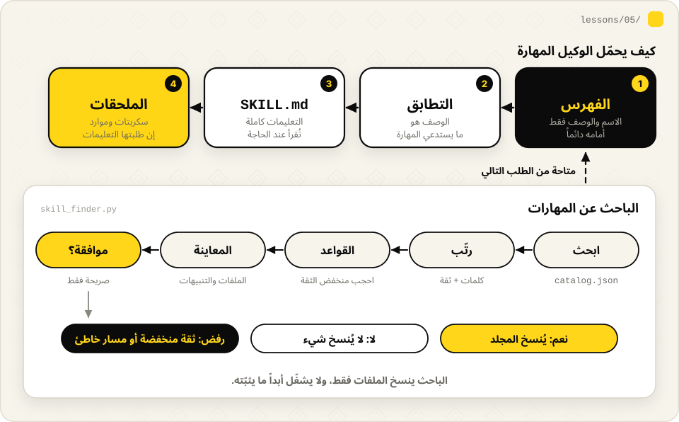

<div dir="rtl">

<p align="center"><a href="../en/05-agent-skills/README.md">English</a> · <b>العربية</b></p>

<p align="center"></p>

<p align="center"></p>

# الدرس 05: مهارات الوكيل الذكي: علّم وكيلك أن يجد مهاراته ويثبّتها بنفسه

**في 45 دقيقة تبني ببايثون «باحثاً عن المهارات»: مهارة تجد لوكيلك الذكي القدرة التي تنقصه، وتعرضها عليك، ولا تثبّتها إلا حين تقول «نعم».** هكذا يكبر وكيلك مهارةً بعد مهارة، دون أن تعيد كتابته، ودون أن تفتح بابه لأي ملف مجهول.

> [!NOTE]
> **ما ستخرج به من هذا الدرس**
>
> - **تفهم مهارة الوكيل من الداخل:** مجلد فيه ملف `SKILL.md` برأس قصير (الاسم والوصف) ثم التعليمات، ومعه سكربتات وموارد إن احتاج.
> - **تكتب وصفاً يستدعي المهارة في وقتها:** لأن الوصف وحده هو ما يقرر به الوكيل أن يفتح المهارة أو يتجاهلها.
> - **تبني أداة بحث ترتّب المهارات** بتطابق الكلمات وبعلامات الثقة، وتحجب المهارة الضعيفة بدل أن تقترحها.
> - **تبني مثبّتاً آمناً:** يعرض ما سيُنسخ قبل أن يسأل، ولا ينسخ إلا بموافقة صريحة، ويرفض كل مسار يحاول الخروج من مكانه، ولا يشغّل شيئاً مما يثبّته.
>
> **المدة المتوقعة:** 45 دقيقة · **ستبني:** فهرس مهارات محلياً، وأداة بحث وترتيب، ومثبّتاً بقواعد أمان، ومهارتنا `skill-finder` التي تربطها كلها. · **الشيفرة:** [`lessons/05/`](../../lessons/05/)

## شغّل الدرس


</div>
<div dir="ltr">

```console
$ python -m pytest tests/test_lesson05.py                               # offline, no API key
$ python lessons/05/skill_loader.py "حوّل التاريخ الهجري إلى ميلادي"     # which skill would load?
$ python lessons/05/skill_finder.py "التاريخ الهجري"                     # search the catalogue
$ python lessons/05/skill_finder.py --install hijri-dates --to my-skills # asks before copying
```

</div>
<div dir="rtl">

لا يحتاج هذا الدرس أي مفتاح: الشيفرة كلها تعمل دون اتصال، والفهرس ملف محلي.

## 1. لماذا يحتاج الوكيل مهارات؟

في الدرس 02 أعطينا الوكيل **أدوات**: دوال يستدعيها، مثل الحاسبة وقارئ الملفات. الأداة تجيب عن سؤال «ماذا أستطيع أن أفعل؟». لكن كثيراً من العمل ليس دالة جديدة، بل **طريقة**: كيف يُكتب محضر اجتماع عندنا؟ بأي ترتيب تُحسب الفاتورة؟ ما الذي لا يُخمَّن أبداً في تحويل التاريخ الهجري؟

يمكنك أن تكتب كل ذلك في تعليمات النظام. لكنها ستطول مع كل طريقة جديدة، ويقرؤها الوكيل كلها في كل طلب، ولو كان الطلب «ما عاصمة فرنسا؟». **المهارة** تحل هذا: حزمة تعليمات صغيرة لعمل واحد، لا يفتحها الوكيل إلا حين يحتاجها.

## 2. ما المهارة؟ مجلد وملف واحد إلزامي

</div>
<div dir="ltr">

```text
hijri-dates/
├── SKILL.md       ← required: header (name + description), then the instructions
├── scripts/       ← optional: helpers the instructions may mention
└── resources/     ← optional: templates, examples, reference text
```

</div>
<div dir="rtl">

وهذا ملف [`SKILL.md`](../../lessons/05/catalog/skills/hijri-dates/SKILL.md) لمهارة من فهرسنا:

</div>
<div dir="ltr">

```markdown
---
name: hijri-dates
description: حوّل التاريخ بين الهجري والميلادي واحسب الفرق بين تاريخين. استعملها حين يذكر المستخدم تاريخاً هجرياً أو يسأل عن موعد رمضان أو عن عدد الأيام بين تاريخين.
---

# تحويل التاريخ الهجري والميلادي

1. اسأل عن التاريخ إن لم يُذكر كاملاً: اليوم والشهر والسنة.
...
```

</div>
<div dir="rtl">

بين سطري `---` **رأس الملف**، وفيه حقلان:

| الحقل | قاعدتنا في هذه الدورة | لماذا |
|---|---|---|
| `name` | حروف إنجليزية صغيرة وأرقام وشرطات، حتى 64 حرفاً، ويطابق اسم المجلد | يصلح اسماً لمجلد على كل نظام، ولا يحمل `/` أو `..` |
| `description` | غير فارغ، حتى 1024 حرفاً، يقول **ماذا تفعل المهارة ومتى تُستعمل** | هو ما يقرأه الوكيل ليقرر |

وبعد الرأس التعليمات نفسها، بلغة عادية وخطوات مرقّمة. الدالة `parse_skill` في [`skill_loader.py`](../../lessons/05/skill_loader.py) تقرأ الملف وتطبّق هذه القواعد، وترفض المخالف برسالة عربية واضحة.

## 3. الوصف هو ما يستدعي المهارة

<p align="center"></p>

<p align="center"></p>

الوكيل لا يقرأ كل المهارات كاملة. يُحمَّل على ثلاث درجات:

1. **دائماً:** سطر واحد لكل مهارة، فيه الاسم والوصف. هذا كل ما يعرفه عنها في البداية.
2. **عند التطابق:** إن وافق الطلبُ وصفَ مهارة، يقرأ ملف `SKILL.md` الخاص بها كاملاً.
3. **عند الطلب:** السكربتات والموارد لا تُفتح إلا إن ذكرتها التعليمات.

فالنتيجة المهمة: **إن لم يقل الوصف متى تُستعمل المهارة، فلن تُستعمل أبداً**، مهما كانت تعليماتها ممتازة.

في الدرس لا يوجد نموذج، فالدالة `pick_skill` تحاكي هذا القرار بتطابق الكلمات: تختار المهارة التي يشارك وصفها الطلبَ في كلمتين على الأقل، وإلا فلا تحمّل شيئاً. الوكيل الحقيقي يفهم المعنى أعمق من عدّ الكلمات، لكن المبدأ واحد: **يقرر بالوصف وحده**.

</div>
<div dir="ltr">

```console
$ python lessons/05/skill_loader.py "حوّل التاريخ الهجري إلى ميلادي"
skills: 6 | always in view: 962 chars | if every SKILL.md were loaded: 2208 chars
loaded: hijri-dates
# تحويل التاريخ الهجري والميلادي
```

</div>
<div dir="rtl">

لاحظ الرقمين: ست مهارات صغيرة تكلّف 962 حرفاً في كل طلب، بدل 2208 لو حُمّلت كلها. والفرق يكبر مع كل مهارة تضيفها وكل تعليمات تطول.

> [!TIP]
> **اكتب الوصف بجملتين.** الأولى: ماذا تفعل المهارة، بفعل أمر. والثانية: «استعملها حين...» بكلمات يكتبها المستخدم فعلاً، لا بكلمات تقنية لا يقولها أحد. وصف مثل «مهارة مفيدة للنصوص» لا يستدعيه أي طلب.

## 4. ابنِ الباحث: الفهرس

الآن نبني مهارة تجد المهارات. أول ما تحتاجه **فهرس**: قائمة بالمهارات المتاحة وما يُعرف عن كل منها. فهرسنا ملف محلي، [`catalog/catalog.json`](../../lessons/05/catalog/catalog.json)، ومجلدات المهارات بجانبه:

</div>
<div dir="ltr">

```json
{
  "name": "hijri-dates",
  "path": "skills/hijri-dates",
  "description": "تحويل التاريخ بين الهجري والميلادي وحساب الفرق بين تاريخين",
  "tags": ["تاريخ", "هجري", "ميلادي", "تقويم", "رمضان", "hijri", "calendar"],
  "installs": 4200,
  "verified": true
}
```

</div>
<div dir="rtl">

| الحقل | معناه |
|---|---|
| `path` | مكان مجلد المهارة، نسبةً إلى مجلد الفهرس |
| `tags` | كلمات إضافية يبحث بها الناس |
| `installs` | عدد مرات التثبيت: علامة ثقة |
| `verified` | هل راجع ناشرُ الفهرس مصدرَ المهارة: علامة الثقة الأقوى |

> [!IMPORTANT]
> أعداد التثبيت في فهرس الدرس **وهمية**، كُتبت للتعلّم فقط. وفي الفهرس عمداً مهارتان لا ينبغي تثبيتهما: `csv-summary` بمصدر غير موثّق وتثبيتات قليلة، و`speed-cleaner` التي تعد بتسريع جهازك وتطلب أن تعمل «دائماً» و«دون أن تسأل».

## 5. الترتيب: صلة بالطلب، ثم ثقة

لكل مهارة رقمان بين 0 و1:

- **الصلة:** نسبة كلمات الطلب الموجودة في اسم المهارة ووصفها ووسومها، بعد توحيد الكتابة العربية (حذف التشكيل، وتوحيد صور الألف، وحذف «ال») كما فعلنا في الدرس 03.
- **الثقة:** 0.6 إن كان المصدر موثّقاً، ثم حتى 0.4 من عدد التثبيتات على مقياس لوغاريتمي، فالقفزة من 10 إلى 100 تثبيت تساوي القفزة من 1000 إلى 10000.

</div>
<div dir="ltr">

```text
score = 0.7 × relevance + 0.3 × trust
```

</div>
<div dir="rtl">

الصلة أولاً، لأن المهارة الموثوقة التي لا تحل مشكلتك لا تنفعك. والثقة ثانياً، لتفصل بين مهارتين متساويتين في الصلة. ومهارة صلتها صفر لا تظهر أصلاً، مهما كثرت تثبيتاتها.

</div>
<div dir="ltr">

```console
$ python lessons/05/skill_finder.py "التاريخ الهجري"
query: التاريخ الهجري
1. hijri-dates | score 0.989 | verified, 4,200 installs
   تحويل التاريخ بين الهجري والميلادي وحساب الفرق بين تاريخين
```

</div>
<div dir="rtl">

## 6. قواعد الجودة: ما لا يقترحه الباحث أبداً

الترتيب وحده لا يكفي، فالمهارة الأعلى رقماً قد تكون خطرة. لذلك أربع قواعد مكتوبة في الشيفرة، لا متروكة للتقدير:

1. **لا اقتراح لمهارة منخفضة الثقة.** غير موثّقة وتثبيتاتها أقل من 500؟ تُحجب في قائمة منفصلة (`held back`)، ولا تدخل الاقتراحات أبداً، ولو كانت النتيجة الوحيدة.
2. **المستخدم يرى قبل التثبيت.** المعاينة تعرض الاسم والوصف والمصدر وعدد التثبيتات وكل ملف سيُنسخ.
3. **لا تشغيل لسكربت مجهول.** إن كان في المهارة ملف غير `SKILL.md`، تقول المعاينة ذلك صراحة. والباحث نفسه لا يشغّل شيئاً، ويثبت اختبارٌ أن شيفرته لا تستورد أي وحدة تشغّل أوامر.
4. **الحذر من وصف يريد كل شيء.** مهارة تطلب أن تعمل «دائماً» أو «مع أي طلب» أو «دون أن تسأل» تحاول أن تفرض نفسها على كل محادثة. هذه علامة خطر تظهر في المعاينة.

</div>
<div dir="ltr">

```console
$ python lessons/05/skill_finder.py "نظف الملفات وسرع الجهاز"
query: نظف الملفات وسرع الجهاز
no trusted skill matches this request
held back (low trust, never recommended): speed-cleaner
```

</div>
<div dir="rtl">

«لم أجد مهارة موثوقة» جواب صحيح. والخطأ أن يقترح الباحث أقرب نتيجة لأنه لم يجد غيرها.

## 7. التثبيت الآمن

الدالة `install` في [`skill_finder.py`](../../lessons/05/skill_finder.py) تنسخ مجلد مهارة واحد إلى مجلد مهاراتك. ترتيب خطواتها هو الدرس نفسه: **كل الفحوص قبل السؤال**، فلا تُهدر موافقتك على مهارة ستُرفض في كل الأحوال.

| الفحص | ما يمنعه |
|---|---|
| الاسم يطابق القاعدة | اسم مثل `../evil` يكتب خارج مجلد المهارات |
| ليست منخفضة الثقة | تثبيت ما حجبه البحث من باب خلفي |
| المسار يبقى داخل مجلد الفهرس | فهرس يشير إلى `../../` لينسخ ملفاتك الخاصة |
| لا روابط رمزية في المجلد | ملف يبدو داخل المهارة وهو يشير إلى ملف خارجها |
| `SKILL.md` صالح واسمه يطابق الفهرس | فهرس يقول اسماً والملف يقول غيره |
| الوجهة غير موجودة | الكتابة فوق مهارة مثبّتة |
| موافقة صريحة | التثبيت بالصمت أو بـ«ربما» |

فحص المسار هو الأهم. لا يكفي أن تبحث عن `..` في النص، فهناك طرق كثيرة لكتابة المسار نفسه. الطريقة الصحيحة: **حوّل المسار إلى شكله الحقيقي الكامل، ثم تأكد أنه ما زال داخل المجلد المسموح:**

</div>
<div dir="ltr">

```python
root = Path(catalog_root).resolve()
source = (root / entry.path).resolve()
if source == root or not source.is_relative_to(root):
    raise InstallError(...)
```

</div>
<div dir="rtl">

والموافقة في الشيفرة تعني `True` فقط. الدالة `confirm` قد تعيد `"yes"` نصاً، أو `1`، أو `None`؛ كلها تعني «لا»، والاختبارات تتأكد من ذلك. وفي الطرفية لا يُقبل إلا أن تكتب «نعم» (أو `y` أو `yes`):

</div>
<div dir="ltr">

```console
$ python lessons/05/skill_finder.py --install hijri-dates --to my-skills
المهارة: hijri-dates
الوصف: تحويل التاريخ بين الهجري والميلادي وحساب الفرق بين تاريخين
المصدر موثّق: نعم | التثبيتات: 4,200
الملفات: SKILL.md
ثبّت؟ اكتب «نعم» للموافقة: نعم
installed: .../my-skills/hijri-dates
```

</div>
<div dir="rtl">

وبعد التثبيت مباشرة، يصبح وصف المهارة الجديدة ضمن الفهرس الذي يراه الوكيل، فيستدعيها من الطلب التالي. الاختبار `test_installed_skill_is_picked_on_the_next_request` يثبت الحلقة كاملة: قبل التثبيت لا مهارة، وبعده تُختار.

## 8. مهارتنا: الباحث عن المهارات

بقي أن نجعل الباحث نفسه **مهارة**، حتى يعرف الوكيل متى يستعمله. هذا ملفنا [`lessons/05/skill-finder/SKILL.md`](../../lessons/05/skill-finder/SKILL.md)، ورأسه:

</div>
<div dir="ltr">

```markdown
---
name: skill-finder
description: ابحث في فهرس المهارات عن مهارة تضيف للوكيل قدرة لا يملكها، واعرضها على المستخدم، وثبّتها بعد موافقته الصريحة فقط. استعملها حين يطلب المستخدم قدرة جديدة، أو يسأل هل توجد مهارة لعمل ما، أو يطلب تثبيت مهارة.
---
```

</div>
<div dir="rtl">

لاحظ أن الوصف نفسه يحمل القاعدة الأهم: «بعد موافقته الصريحة فقط». فالوكيل يقرأ هذا الشرط قبل أن يفتح التعليمات أصلاً. وفي التعليمات ثماني خطوات: لخّص الحاجة، وابحث، واعرض ثلاث نتائج على الأكثر، ولا تقترح المحجوب أبداً، واعرض المعاينة كاملة، وانتظر موافقة صريحة، وثبّت، وأخبر المستخدم بالمسار. ثم قواعد لا تُكسر، أولها: لا تشغّل سكربتاً من مهارة قبل أن يقرأها المستخدم.

## 9. متى لا تحتاج مهارة؟

- **عمل يتكرر في كل طلب:** مكانه تعليمات النظام، لا مهارة تُفتح كل مرة.
- **قدرة جديدة فعلاً**، كالاتصال بخدمة أو حساب لا يستطيعه النموذج: هذه **أداة**، كما في الدرس 02. والمهارة قد تشرح متى تُستدعى الأداة وكيف.
- **تعليمات من سطرين:** اكتبها في طلبك مباشرة.

## أخطاء شائعة


| الخطأ | ما يحدث | الصواب |
|---|---|---|
| وصف يقول ماذا تفعل المهارة ولا يقول متى | لا يستدعيها الوكيل أبداً | جملة ثانية: «استعملها حين...» بكلمات المستخدم |
| وصف يطلب أن تعمل «دائماً» | تُفتح في كل محادثة، وتزاحم غيرها | وصف محدد بحالات واضحة |
| ترتيب بعدد التثبيتات وحده | الأشهر يسبق الأنسب، والعدد يمكن تضخيمه | الصلة أولاً، والثقة لفصل المتساويين |
| اقتراح أقرب نتيجة حين لا يوجد موثوق | تثبيت مهارة ضعيفة لأنها «الوحيدة» | «لم أجد» جواب مقبول |
| فحص المسار بالبحث عن `..` في النص | مسارات ملتوية تفلت من الفحص | حوّل المسار إلى شكله الكامل ثم قارن بالمجلد المسموح |
| السؤال قبل الفحوص | يوافق المستخدم ثم يُرفض التثبيت | كل الفحوص أولاً، ثم السؤال |
| تشغيل سكربت المهارة «لتجربتها» | تنفّذ شيفرة لم يقرأها أحد | اقرأ أولاً، وشغّل بعد موافقة صريحة |

## اختبر نفسك


1. ما الشيء الوحيد الذي يراه الوكيل عن كل مهارة قبل أن يحتاجها؟ وماذا يعني ذلك لكاتب المهارة؟
2. مهارتان تطابقان الطلب بالقدر نفسه، إحداهما موثّقة بـ 600 تثبيت والأخرى غير موثّقة بـ 5000. أيهما تظهر أولاً في باحثنا؟
3. لماذا لا يكفي أن نرفض كل مسار فيه `..`؟
4. لماذا تجري كل الفحوص قبل سؤال المستخدم، لا بعده؟
5. فحصتَ سكربتات مهارة فلم تجد فيها شيئاً مريباً. هل صارت آمنة؟

<details>
<summary><b>الإجابات</b></summary>

1. الاسم والوصف فقط. فالوصف يجب أن يقول ماذا تفعل المهارة ومتى تُستعمل، وإلا فلن يفتحها الوكيل أبداً.
2. الموثّقة: ثقتها `0.6 + 0.4 × log10(601) / 4`، أي نحو 0.88، والأخرى نحو 0.37، والصلة متساوية. التوثيق يزن أكثر من العدد.
3. لأن المسار نفسه يُكتب بطرق كثيرة، وقد يمرّ عبر رابط رمزي. الطريقة الصحيحة أن تحوّله إلى شكله الحقيقي الكامل ثم تتأكد أنه داخل المجلد المسموح.
4. حتى لا يوافق المستخدم على تثبيت سيُرفض في كل الأحوال، وحتى تعرض المعاينة مهارة تحقّقنا من صلاحيتها، لا مهارة قد تتغير بعد الموافقة.
5. لا. الخطر قد يكون في التعليمات نفسها، مثل «شغّل فوراً دون أن تسأل». الفحص الآلي يكشف العلامات السهلة، والحكم الأخير لإنسان قرأ المهارة.

</details>

## تمارين

1. **المهارة القديمة أقل ثقة:** أضف إلى الفهرس تاريخ آخر تحديث لكل مهارة، واكتب `fresh_trust(entry, updated, today)` تنصّف الثقة إن مرّت سنة على آخر تحديث، و`held_back(...)` تحجب القديمة غير الموثّقة ولو كثرت تثبيتاتها.
2. **اقرأ السكربتات قبل أن يشغّلها أحد:** اكتب `audit(folder)` تفتح كل ملف في المهارة نصاً، وتعيد اسم الملف ورقم السطر والسبب لكل علامة مريبة: حذف قسري، أو تنزيل من الشبكة، أو تمرير ناتج أمر إلى مفسّر، أو قراءة مفاتيح. دون تشغيل أي شيء. ثم جرّبها على `speed-cleaner`، وفسّر النتيجة.
3. **أصلح وصفاً لا يعمل:** خذ مهارة وصفها «مهارة مفيدة»، وأعد كتابة الوصف بجملتين حتى تختارها `pick_skill` لطلب «اكتب محضر هذا الاجتماع».

الحلول في [`solutions/05/`](../../solutions/05/).

## مصطلحات الدرس

مهارة الوكيل · ملف المهارة · رأس الملف · وصف المهارة · التحميل التدريجي · فهرس المهارات · علامات الثقة · مصدر موثّق · المهارة المحجوبة · معاينة التثبيت · الموافقة الصريحة · اجتياز المسار · الرابط الرمزي

التعريفات الكاملة في [المسرد](../glossary.md).

<p align="center"></p>

<p align="center">إن ساعدك هذا الدرس، فنجمة على المستودع تخبرنا أنه يستحق، وتساعد غيرك على الوصول إليه.</p>

---

<p align="center"><b>السابق:</b> <a href="../04-spec-driven/README.md">الدرس 04: التطوير الموجّه بالمواصفات</a> · <a href="../../README.md#خريطة-الدورة">خريطة الدورة</a> · <b>التالي:</b> الدرس 06 في خريطة الدورة</p>

</div>
