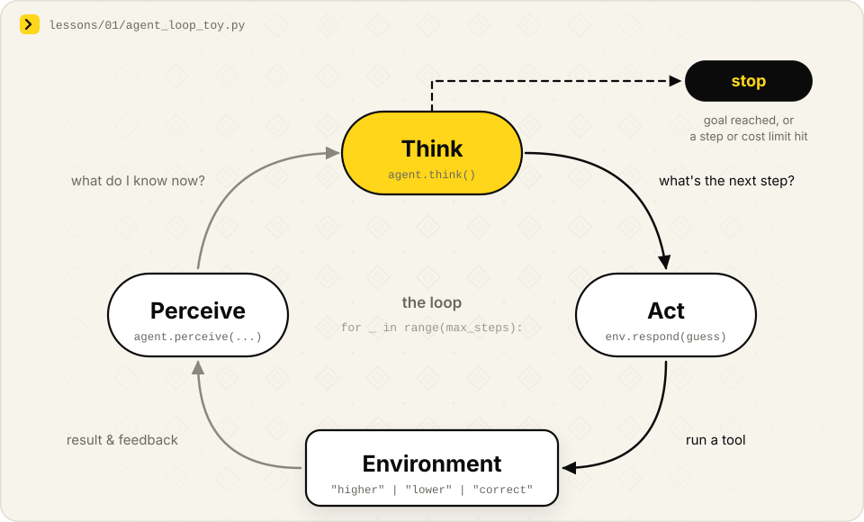

<p align="center"><b>English</b> · <a href="../../01-what-is-an-agent/README.md">العربية</a></p>

<p align="center"></p>

<p align="center"></p>

# Lesson 01: What is an agent?

> [!NOTE]
> **What you'll learn**
>
> - Tell a large language model, a workflow and an agent apart, precisely.
> - Understand the "perceive, think, act" loop and the stopping condition.
> - Know when **not** to build an agent.
> - Send your first request to the model and read its response correctly.
>
> **Time:** about 45 minutes · **You'll build:** a simple agent loop with no AI at all, then your first real request to a language model. · **Code:** [`lessons/01/`](../../../lessons/01/)

## Run it


```console
$ python lessons/01/agent_loop_toy.py       # no API key needed
$ python lessons/01/first_call.py "ما الفرق بين النموذج اللغوي والوكيل؟"   # needs ANTHROPIC_API_KEY
```

## 1. The large language model: a text-to-text function

A large language model (LLM) is a program trained on a huge amount of text, which makes it able to generate text that fits whatever it is given. From a programmer's point of view it is a function: you send it messages, and it returns a reply.

Three properties govern everything we will build:

1. **It has no memory between requests.** Every request stands alone. If you want it to "remember", you have to send it the earlier conversation yourself.
2. **It does nothing in the world.** It only writes text. It doesn't read your files or send email, unless you write code that does that on its behalf.
3. **Its knowledge is limited** to what it was trained on and what you send it in the request.

## 2. Three levels: a single call, a workflow, an agent

| Level | Who decides the next step? | Example |
|---|---|---|
| Single call | There is no next step | "Summarize this paragraph" |
| Workflow | **Your code** fixes the steps in advance | Translate the text, then fix its spelling, then extract the headings |
| Agent | **The model** decides what to do at every step | "Search these documents and answer me with sources" |

**The definition we use in this course:** an agent is a system that uses a language model to decide its own steps inside a loop: it picks a tool, your code runs it, it sees the result, then it decides again, until the goal is reached or a stopping limit is hit.

> [!IMPORTANT]
> **In short:** agent = model + tools + loop + stopping condition. If any one of them is missing, it isn't an agent.

## 3. The loop: perceive, think, act

<p align="center"></p>

<p align="center"></p>

- **Perceive:** what the agent knows right now: the user's request and the results of earlier tools.
- **Think:** choose the next step. In a real agent, this is the model's job.
- **Act:** carry out the step in the environment, such as reading a file or doing a calculation.
- **Environment:** the world that the action affects and that returns a result.
- **Stop:** every loop needs a clear way out: the goal is reached, or a step or cost limit is hit.

> [!WARNING]
> **Careful:** a loop without a stopping condition is a bug waiting for its moment.

### The loop with no AI

Before we bring the model in, let's look at the bare loop. In [`agent_loop_toy.py`](../../../lessons/01/agent_loop_toy.py) a secret number is hidden in the "environment", and the agent can't see it. It can guess (act), read the reply "higher", "lower" or "correct" (perceive), and choose its next guess by binary search (think):

```python
def run(env, max_steps=10):
    agent = GuessingAgent(low=env.low, high=env.high)
    for _ in range(max_steps):              # guard: a hard step limit
        guess = agent.think()               # think
        feedback = env.respond(guess)       # act; the world reacts
        agent.perceive(guess, feedback)     # perceive (and remember)
        if feedback == "correct":           # stop: goal reached
            return True, agent.history
    return False, agent.history             # stop: limit reached
```

Run it:

```bash
python lessons/01/agent_loop_toy.py
```

> [!TIP]
> **The key idea of this lesson:** notice that the "brain" here is fixed code. In Lesson 02 we swap it for a language model, and the loop keeps exactly the same shape. **The agent is a loop you write; the model is the part that decides inside it.**

## 4. When not to build an agent

An agent is slower, more expensive and harder to test than a single call. Before you build one, ask four questions. If the answer to any of them is "no", pick a simpler level:

1. **Complexity:** is the task multi-step, with steps that are hard to define in advance?
2. **Value:** is the result worth the extra cost and time?
3. **Capability:** is the model actually capable of this kind of task?
4. **Cost of error:** can mistakes be caught and fixed (tests, review, rollback)?

| Task | Right choice | Why |
|---|---|---|
| Classify a message as "complaint" or "inquiry" | Single call | One known step |
| Turn an invoice into data, save it, then send a notification | Workflow | The steps are fixed and known |
| Answer a question from hundreds of documents, citing sources | Agent | You can't know in advance which documents need searching |
| Execute money transfers automatically | No agent without human approval | The cost of error is high and can't be undone |

## 5. Your first real request to the model

Now we send a single request. It isn't an agent yet, but it is the building block every agent is made from. The file [`first_call.py`](../../../lessons/01/first_call.py):

```python
import anthropic

client = anthropic.Anthropic()  # reads ANTHROPIC_API_KEY from the environment

response = client.messages.create(
    model="claude-opus-5-5",
    max_tokens=16000,                    # a ceiling, not a target
    output_config={"effort": "low"},     # low | medium | high | xhigh | max
    system="أنت مساعد تعليمي. أجب بالعربية الفصحى في ثلاث جمل على الأكثر.",
    messages=[{"role": "user", "content": "ما الفرق بين النموذج اللغوي والوكيل؟"}],
)

if response.stop_reason == "refusal":
    print("the model declined")
else:
    print("".join(b.text for b in response.content if b.type == "text"))
print(response.usage.input_tokens, response.usage.output_tokens)
```

(The system prompt asks the model to act as a teaching assistant and answer in formal Arabic in at most three sentences; the question asks for the difference between a language model and an agent.)

Run it (needs a key):

```bash
python lessons/01/first_call.py "ما الفرق بين النموذج اللغوي والوكيل؟"
```

### Request fields

| Field | Meaning |
|---|---|
| `model` | The model ID. We make it switchable through `AGENT_MODEL`. |
| `max_tokens` | The maximum number of tokens the reply may produce. A ceiling, not a target: you only pay for what is actually generated. |
| `system` | The system prompt: the role and the general rules. |
| `messages` | The conversation: a list of messages, each with a `role` (`user` or `assistant`) and `content`. The first message always comes from `user`. |
| `output_config.effort` | The effort level: how much the model thinks, and how much it consumes. |

### Response fields

| Field | Meaning |
|---|---|
| `content` | A **list** of content blocks, not a single string. They can be of type `text`, `thinking` and `tool_use`. |
| `stop_reason` | Why the model stopped: `end_turn` (finished), `max_tokens` (cut off), `tool_use` (asking for a tool), `refusal` (declined). |
| `usage` | The number of input and output tokens, which is the basis of the cost. |

### A note on thinking in Claude Opus 5.5

`claude-opus-5-5` always thinks adaptively before it answers, and thinking can't be turned off on this model; sending `thinking: {"type": "disabled"}` returns a 400 error. What you control is the **effort level**, whose default on this model is `medium`.

> [!WARNING]
> **Heads up:** the response may contain a `thinking` block before the text block. That is why we never read `content[0].text` directly; we filter the blocks by type.

### Every provider has its own names; the concepts are the same

The examples use the official Anthropic library, but the concepts in this lesson are general: messages with roles, a system prompt, a stop reason and a token counter. You'll find all of them at any other model provider under slightly different names.

## Common mistakes


| Mistake | Why it's wrong | Do this instead |
|---|---|---|
| Reading `response.content[0].text` directly | The first block may be `thinking`, not `text` | Filter blocks by `block.type` |
| Ignoring `stop_reason` | The reply may be cut off (`max_tokens`) or declined (`refusal`) | Check it before trusting the content |
| Assuming the model remembers the previous question | The API keeps no state between requests | Send the whole conversation in `messages` |
| Building an agent for a one-step task | Cost, latency and complexity for no benefit | Start with the simplest level that works |
| A loop with no step limit | It may spin forever and burn your credit | Put `max_steps` in every loop |

## Check yourself


1. What are the four elements without which an agent is not an agent?
2. What is the difference between a workflow and an agent in terms of who decides the next step?
3. Why don't we read `response.content[0].text` directly with Opus 5.5?
4. Name two stopping conditions we used in `agent_loop_toy.py`.
5. Task: "extract the invoice date from a short text". Would you build an agent for it? Why?

<details>
<summary><b>Answers</b></summary>

1. A model, tools, a loop and a stopping condition.
2. In a workflow your code fixes the steps in advance; in an agent the model decides them on every iteration.
3. Because the content is a list of blocks, and a `thinking` block may come first.
4. Reaching the goal (`"correct"`) and hitting the step limit (`max_steps`). There is also a third, defensive one: an impossible state (`low > high`).
5. No. It is one known step, and a single call is enough.

</details>

## Exercises

1. **Minimum steps:** change the secret number's range to 1 to 1000. What is the smallest `max_steps` that guarantees the agent finds any number? Work it out on paper, then check it with code.
2. **Brief answer:** write a function `ask_brief(client, question)` that returns a pair `(text, stop_reason)`, asks the model to answer in two or three sentences, and states any uncertainty.
3. **Classify the tasks:** for each task below, choose "single call", "workflow" or "agent", and explain why: (a) translating a tweet. (b) searching a code repository for the cause of an unknown bug. (c) producing a weekly report with fixed sections from a database. (d) answering customer questions from a long user manual, citing the page.

Solutions in [`solutions/01/`](../../../solutions/01/README.en.md).

## Key terms

Large Language Model · Agent · Workflow · Loop · Perceive · Think · Act · Environment · Stopping Condition · System Prompt · Content Block · Stop Reason · Adaptive Thinking

Full definitions in the [glossary](../glossary.md).


<p align="center"></p>

---

<p align="center"><b>Previous:</b> <a href="../00-setup/README.md">Lesson 00: Setting up your workspace</a> · <a href="../../../README.en.md#course-map">Course map</a> · <b>Next:</b> <a href="../02-tools/README.md">Lesson 02: Tools from scratch</a></p>
