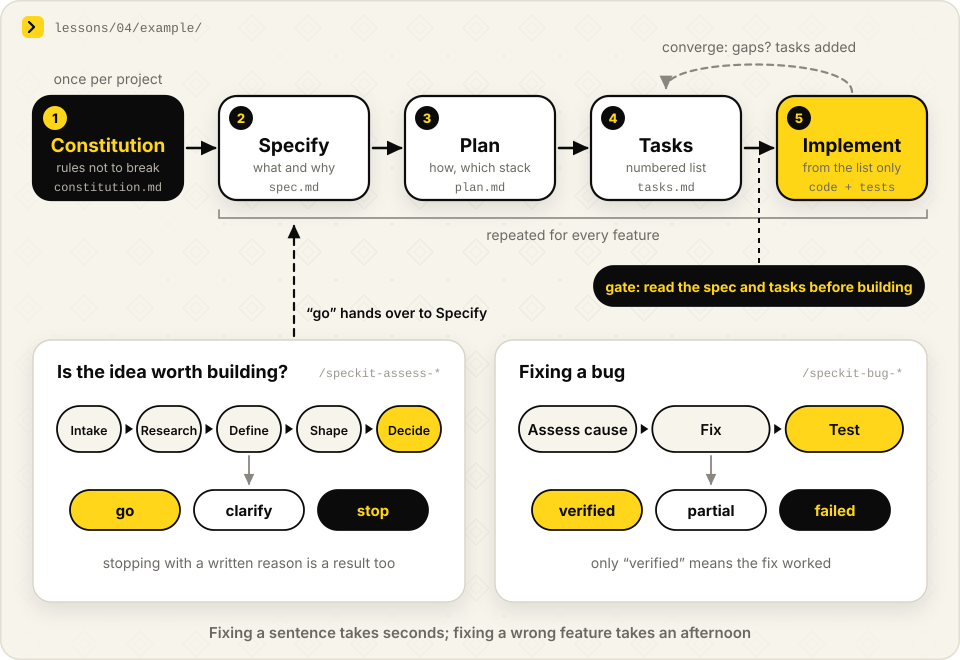

<p align="center"><b>English</b> · <a href="../../04-spec-driven/README.md">العربية</a></p>

<p align="center"></p>

<p align="center"></p>

# Lesson 04: Spec-driven development

> [!NOTE]
> **What you'll learn**
>
> - Why a coding agent goes wrong when you hand it a one-line idea, and how to stop that before it writes a single line of code.
> - The five steps: constitution, then specify, then plan, then tasks, then implement.
> - The most important habit: read the spec and the task list yourself before you let the agent build.
> - A short path for fixing bugs, and a way to decide whether an idea is worth building at all.
> - How to apply all of it with the open-source Spec Kit toolkit and an agent such as Claude Code.
>
> **Time:** about 60 minutes · **You'll build:** a VAT invoice calculator that accepts Arabic digits, taken through all five steps with real files, and a small tool that checks the spec and the tasks before building. · **Code:** [`lessons/04/`](../../../lessons/04/)

## Run it


```console
$ python -m pytest tests/test_lesson04.py                    # offline, no API key
$ python lessons/04/spec_check.py lessons/04/example         # read the spec before building
$ python lessons/04/vat_invoice.py "قهوة=١٥" "كعكة=٢٢٫٥"     # the feature built from it
```

This lesson needs no API key: all the code runs offline.

The example files in `lessons/04/example/` are written in Arabic, because the course builds for Arabic users first. This page explains each of them in English.

## 1. Why "write me a feature" isn't enough

A coding agent such as Claude Code carries out what it understands from your request, and fills whatever you didn't say with a guess that seems reasonable to it. Ask for "an invoice calculator with VAT" and it will decide dozens of things without asking you: is VAT charged per line or on the subtotal? How are amounts rounded? Does it accept 15 written in Arabic-Indic digits? What does it do with a negative amount?

Each of those decisions may be right, or may not. The problem is that you only see the decision once it has become code, then tests, then perhaps a habit in your team's work.

Spec-driven development flips the order: **the decisions are written first in plain language, a person reads them, and then the code is built from them.** The idea isn't new to this course: in Lesson 03 the agent wrote its plan into a `write_plan` tool so that it could be inspected before it ran. Here we apply the same principle to a whole project.

## 2. The five steps

<p align="center"></p>

<p align="center"></p>

| Step | The question it answers | File | When it is written |
|:---:|---|---|---|
| 1 | Which rules must never be broken in this project? | [`constitution.md`](../../../lessons/04/example/constitution.md) | once per project |
| 2 | What are we building, for whom, and why? | [`spec.md`](../../../lessons/04/example/spec.md) | for every feature |
| 3 | How will we build it, with which stack? | [`plan.md`](../../../lessons/04/example/plan.md) | for every feature |
| 4 | What are the small, ordered steps? | [`tasks.md`](../../../lessons/04/example/tasks.md) | for every feature |
| 5 | The code and the tests | [`vat_invoice.py`](../../../lessons/04/vat_invoice.py) | for every feature, from the list only |

The agent can draft every one of these files. You are the one who reads, corrects and approves before moving on to the next step.

## 3. Step one: the constitution

The constitution is a short file of project-wide rules that the agent reads before every feature. It answers three questions: what are the quality standards? What are the testing requirements? And what must **not be touched**? From our example's constitution:

> 1. **Financial accuracy first.** Every amount is computed with `Decimal`; `float` is never used for money.
>
> **Not to be touched:** the requirements file `requirements.txt`: no new libraries, the standard library is enough.

Notice that every rule **can be checked**. "Write clean code" is checked by no one. "No `float` for money" is checked by a one-line test, which really is in `tests/test_lesson04.py`.

> [!TIP]
> The "not to be touched" section is the most valuable part of the constitution. An eager agent may "improve" a file you never asked it to change, or add a library to save ten lines. One line in the constitution prevents that in every future feature.

## 4. Step two: the spec

The spec describes **what and why, only**. No programming language and no file names; those belong in the plan. It starts with the idea as its owner said it, then turns it into parts that can be checked:

| Part | Example from [`spec.md`](../../../lessons/04/example/spec.md) |
|---|---|
| The user and their story | a café owner types the items and their prices, and wants the subtotal, the VAT and the total |
| Numbered requirements | requirement 2: VAT at 15% is computed once on the subtotal, not on each line separately |
| Acceptance scenarios | given coffee at 15 and cake at 22.5, when the invoice is computed, the total is 43.13 |
| Out of scope | discounts, other currencies, printing the invoice |
| Questions already settled | is "," a decimal separator? Settled: no, it only separates thousands |

Three rules make a spec useful to an agent:

1. **Number every requirement.** The number is the thread that ties the requirement to its task and then to its test.
2. **Write acceptance scenarios with real numbers.** "VAT is computed accurately" can't be tested. "37.50 gives VAT of 5.63" can.
3. **Don't hide what you don't know.** Every open point is marked with the Arabic tag meaning "needs clarification", and implementation does not start while a single one is left.

## 5. Step three: the plan

Only now does technology come in: the language, the libraries, the files, the design decisions. Every decision in [`plan.md`](../../../lessons/04/example/plan.md) names the requirement it serves:

| Decision | Serves |
|---|---|
| VAT is computed on the subtotal after rounding it | requirements 2 and 3 |
| When splitting VAT out of an inclusive price: round the net, then VAT = total − net | requirement 4 |

The second decision shows what a plan is worth. If we rounded the net and the VAT separately, their sum would sometimes differ from the original price by a halala. That's a bug you would struggle to notice in a code review, and would notice very easily in one line of a plan.

## 6. Step four: the tasks

The task list is an ordered list of small steps, each pointing at one or more requirements. In the Arabic file a task looks like this: a checkbox, the task number, the requirement numbers in brackets, then the work, for example "compute the subtotal, then VAT on the subtotal, then the total, and test the coffee-and-cake scenario".

A good task is small enough to review on its own, and names what proves it is done (usually a test). The order matters: setup, then the foundation every story needs, then one story at a time, then the finishing work.

## 7. Step five: implement

The agent builds **from the list only**: a task, then its test, then a ✓ against it, then the next. If it needs something that isn't on the list, that means the spec or the plan is incomplete, and the right move is to stop and amend that file, not to improvise.

After implementing comes **convergence**: comparing the code against the spec, the plan and the tasks. If something is missing, new tasks are added to the list for it, they are implemented, and the comparison runs again, until nothing is missing.

In our example, every function in [`vat_invoice.py`](../../../lessons/04/vat_invoice.py) names the requirement it serves, and every test in `tests/test_lesson04.py` starts with the requirement number. That way you can trace any line of code back to the reason it exists.

## 8. The most important habit: read before you build

> [!IMPORTANT]
> **Fixing a sentence in the spec takes seconds; fixing a feature built wrong takes an afternoon.** So the gate between "tasks" and "implement" in the diagram is not a formality: don't let the agent build before you have read the spec and the task list yourself.

What do you look for as you read?

1. Does every requirement say one thing that can be tested?
2. Does every requirement have at least one task? Does every task have a requirement?
3. Is any "needs clarification" tag left?
4. Does the spec contain words like "fast", "easy" or "suitable" that mean nothing specific?
5. Does the plan contradict anything in the constitution?

The first three questions are mechanical, so we wrote a small tool for them in [`spec_check.py`](../../../lessons/04/spec_check.py):

```console
$ python lessons/04/spec_check.py lessons/04/example
requirements: 6 | tasks: 8
ready to build: yes | done: yes
```

If you deleted task 7 from the list, the tool would tell you that requirement 4 has no task, and that the feature is not ready to build. The fourth question is the subject of the second exercise. The fifth stays with you: the tool catches the easy gaps, and judging whether a requirement is any good is a person's job.

## 9. The bug-fixing path

Not all work is a new feature. When a bug shows up, the path is shorter, and three steps are enough:

| Step | What happens | What gets written |
|---|---|---|
| Assess | What exactly is the symptom? How is it reproduced? What is the cause, not just where it shows? | a short report: symptom, cause and the scope of the fix |
| Fix | The smallest change that deals with the cause, inside the written scope only | the change, and a test that fails before it and passes after |
| Test | Is the original symptom itself gone? Did anything else break? | one verdict: verified, partial or failed |

Only "verified" means the fix worked. "Partial" means the symptom eased but didn't disappear, and "failed" means going back to assessing, not trying another fix by guesswork.

## 10. Is the idea worth building?

The cheapest feature is the one you decided not to build. Before the spec, ask a few questions and answer each with "yes, with evidence", "no", or "we don't know yet". The `assess` function in `spec_check.py` applies a simple rule:

| The answers | The decision |
|---|---|
| a clear "no" to at least one question | **stop**, and write down why |
| no "no", but some "we don't know yet" | **clarify**: gather what's missing, then assess again |
| all "yes", with evidence | **go**: move on to writing the spec |

Stopping with a written reason is a useful result, not a failure. Someone will suggest the same idea six months from now, and the answer will already be written down.

## 11. The same method with Spec Kit

Everything above is a way of working that you can apply with ordinary files, as we did. GitHub has also published an open-source toolkit called [Spec Kit](https://github.com/github/spec-kit) that sets these steps up for a coding agent: file templates, and commands you type in the agent's chat for each step. We checked these facts against the official repository and its documentation on 17 November 2026. Tools change, so always go back to them:

- **License:** MIT.
- **Requirements:** Python 3.11 or later, the `uv` tool, and a supported coding agent, on Linux, macOS or Windows.
- **Supported agents:** a long list, including Claude Code, GitHub Copilot, Gemini CLI, Cursor and Codex CLI. Each agent has an integration key; Claude Code's is `claude`.
- **At the time of writing** (17 November 2026) the repository had about 150 thousand stars.

Install and create a project, in the terminal:

```bash
uv tool install specify-cli
specify init my-project --integration claude
cd my-project
```

Then in the agent's chat, not the terminal, one command at a time, reviewing each result before the next:

```text
/speckit-constitution
/speckit-specify
/speckit-plan
/speckit-tasks
/speckit-implement
/speckit-converge
```

| Command | Matches, in this lesson |
|---|---|
| `/speckit-constitution` | the constitution, once per project |
| `/speckit-specify` | the spec, from your description of the idea |
| `/speckit-plan` | the plan; you tell it the stack you want |
| `/speckit-tasks` | the task list |
| `/speckit-implement` | implementing from the list |
| `/speckit-converge` | convergence: repeated with implement until it reports that the implementation matches the spec |

There are also optional review commands: `/speckit-clarify` after the spec and before the plan, which asks about underspecified areas and writes the answers into the spec; `/speckit-checklist` after the plan and before the tasks; and `/speckit-analyze` after the tasks and before implementing, which only reads, and reports conflicts and gaps across the three files. That last one is the closest thing in the toolkit to `spec_check.py`.

The two other paths are extensions you install when you need them:

```bash
specify extension add bug      # /speckit-bug-assess, /speckit-bug-fix, /speckit-bug-test
specify extension add assess   # /speckit-assess-intake ... /speckit-assess-decide
```

The bug path keeps its reports in `.specify/bugs/` and ends in one of three verdicts: `verified`, `partial` or `failed`. The idea-assessment path goes through five stages (intake, research, define, shape and decide), keeps its files in `.specify/assessments/`, and ends in one of three decisions: `go`, `needs-clarification` or `kill`. On `go`, the decision's handoff summary is passed to `/speckit-specify`.

> [!NOTE]
> **Command syntax differs between agents.** In Claude Code the commands are installed as skills in `.claude/skills/` and invoked with a hyphen, such as `/speckit-specify`. Older articles may show a dotted form, and other agents may use another form. Follow your agent's page in the official documentation.

## 12. When you don't need all this

Fixing a typo, changing a colour, one obvious line: just ask for it. The five steps are worth their cost when a feature is too big to review at a glance, or when a mistake in it is expensive, as with money, permissions and data. There's a sensible middle ground too: a one-page spec and a task list, without a separate plan.

## Common mistakes


| Mistake | What happens | Do this instead |
|---|---|---|
| Letting the agent implement without reading the spec and tasks | You find the wrong decision after it has become code and tests | The gate: read and approve before implementing |
| Putting technology in the spec | The plan is fixed before the problem is understood | Spec: what and why. Plan: how |
| Requirements with no numbers and no scenarios | You can't tell which test proves which requirement | Number every requirement and write a scenario with real numbers |
| Leaving "needs clarification" tags and building anyway | The agent fills the gap with a guess | Settle the question first and write the answer into the spec |
| A constitution of vague phrases like "clean code" | A rule no one checks | Checkable rules, and a "not to be touched" section |
| Fixing a bug before understanding its cause | The symptom disappears here and appears there | Assess, then fix, then test the original symptom |
| Editing the code by hand without updating the spec | The spec now lies, and the agent reads it for the next feature | Change the spec first, then the code |

## Check yourself


1. What goes in the spec, and what goes in the plan?
2. Why do we number requirements, and where does the number show up in tasks and tests?
3. What does the verdict "partial" mean in the bug-fixing path, and what comes next?
4. You answered an idea's assessment questions with "yes, yes, we don't know yet, yes". What's the decision? And if one of the answers were "no"?
5. Why does the "not to be touched" section of the constitution matter with a coding agent in particular?

<details>
<summary><b>Answers</b></summary>

1. The spec: what we're building, for whom and why, with no technology. The plan: how we'll build it, with which language, libraries, files and design decisions.
2. The number ties a requirement to the task that delivers it and to the test that proves it, so you can trace any line of code back to its reason, and automatically spot a requirement with no task.
3. The symptom eased but didn't disappear. Next you go back to assessing, to understand what is left of the cause, not another fix by guesswork.
4. "Clarify": gather what's missing, then assess again. If one were a clear "no", the decision would be "stop", with the reason written down.
5. Because the agent may change things you didn't ask for in the name of improvement, such as adding a library or editing an old file. A written rule is read for every feature, so you don't have to repeat it.

</details>

## Exercises

1. **Add a requirement the right way:** the café owner wants a discount on the invoice. Don't start with code: write requirement 7 into the spec (is the discount taken before or after VAT? What if it's larger than the subtotal?), add its tasks, run `spec_check.py`, then implement `totals_with_discount(lines, discount)`.
2. **Catch the vague words:** write `vague_lines(spec_text)` that returns the line number and the word for every vague word such as the Arabic for "fast", "easy", "suitable" and "etc.", even with a leading conjunction, preposition or definite article, or with diacritics. Then make sure the example spec contains none.
3. **A bug path on paper:** a user typed `طاولة=١٥٫٠٠٠` meaning fifteen thousand, and the invoice came out at fifteen riyals. Write the assessment report (symptom, how to reproduce it, likely cause, scope of the fix), then the test that fails before the fix, then your verdict. (A writing exercise, with no code solution.)

Solutions are in [`solutions/04/`](../../../solutions/04/).

## Key terms

Spec-Driven Development · Constitution · Specification · Requirement · Acceptance Scenario · Out of Scope · Technical Plan · Task List · Traceability · Convergence · Review Gate · Verification Verdict · Idea Assessment

Full definitions in the [glossary](../glossary.md).


<p align="center"></p>

---

<p align="center"><b>Previous:</b> <a href="../03-first-agent/README.md">Lesson 03: A first real agent</a> · <a href="../../../README.en.md#course-map">Course map</a> · <b>Next:</b> <a href="../05-agent-skills/README.md">Lesson 05: Agent skills</a></p>
