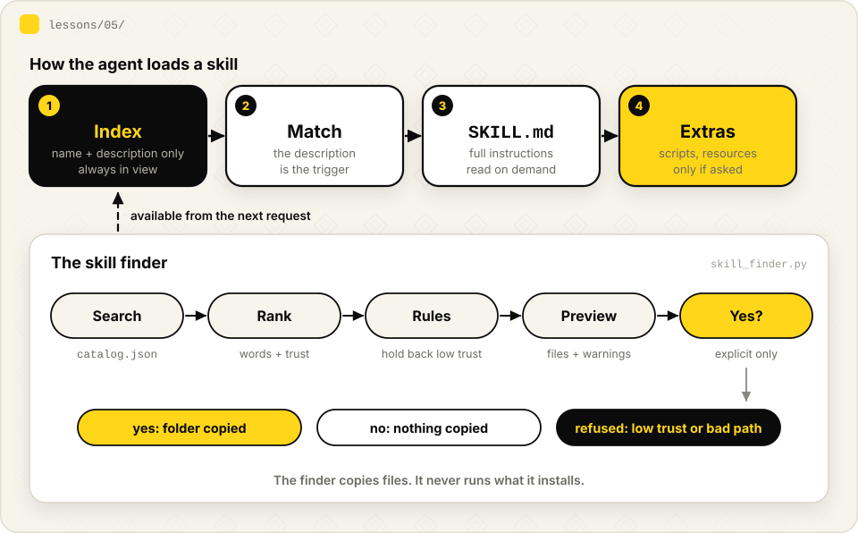

<p align="center"><b>English</b> · <a href="../../05-agent-skills/README.md">العربية</a></p>

<p align="center"></p>

<p align="center"></p>

# Lesson 05: Agent skills: teach your AI agent to find and install its own skills

**In 45 minutes you'll build a "skill finder" in Python: a skill that finds the capability your AI agent is missing, shows it to you, and installs it only when you say yes.** Your agent grows one skill at a time, without being rewritten and without opening its door to unknown files. This tutorial is the safe way to add automation to an agent.

> [!NOTE]
> **What you'll walk away with**
>
> - **Agent skills from the inside:** a folder with a `SKILL.md` file, a short header (name and description), then the instructions, plus scripts and resources when needed.
> - **A description that triggers the skill at the right time:** the description is the only thing the agent uses to decide whether to open a skill or ignore it.
> - **A search tool that ranks skills** by word overlap and trust signals, and holds back a weak skill instead of recommending it.
> - **A safe installer:** it shows what will be copied before it asks, copies only on an explicit yes, refuses any path that tries to escape, and never runs anything it installs.
>
> **Time:** about 45 minutes · **You'll build:** a local skill catalogue, a search and ranking tool, an installer with safety rules, and our own `skill-finder` skill that ties them together. · **Code:** [`lessons/05/`](../../../lessons/05/)

## Run it


```console
$ python -m pytest tests/test_lesson05.py                               # offline, no API key
$ python lessons/05/skill_loader.py "حوّل التاريخ الهجري إلى ميلادي"     # which skill would load?
$ python lessons/05/skill_finder.py "التاريخ الهجري"                     # search the catalogue
$ python lessons/05/skill_finder.py --install hijri-dates --to my-skills # asks before copying
```

This lesson needs no API key: all the code runs offline, and the catalogue is a local file.

The catalogue skills and the example requests are written in Arabic, because the course builds for Arabic users first. The second command asks the loader which skill fits the request "convert the Hijri date to Gregorian"; the third searches the catalogue for "the Hijri date".

## 1. Why does an agent need skills?

In Lesson 02 we gave the agent **tools**: functions it can call, such as the calculator and the file reader. A tool answers "what can I do?". But a lot of work isn't a new function, it's a **method**: how do we write meeting minutes here? In which order is an invoice computed? What must never be guessed when converting a Hijri date?

You could write all of that into the system prompt. But it grows with every new method, and the agent reads all of it on every request, even when the request is "what's the capital of France?". A **skill** solves this: a small bundle of instructions for one job, which the agent opens only when it needs it.

## 2. What is a skill? A folder and one required file

```text
hijri-dates/
├── SKILL.md       ← required: header (name + description), then the instructions
├── scripts/       ← optional: helpers the instructions may mention
└── resources/     ← optional: templates, examples, reference text
```

Here is the [`SKILL.md`](../../../lessons/05/catalog/skills/hijri-dates/SKILL.md) of a skill from our catalogue (the description says: convert between Hijri and Gregorian dates and count the days between two dates; use it when the user mentions a Hijri date, asks when Ramadan starts, or asks how many days lie between two dates):

```markdown
---
name: hijri-dates
description: حوّل التاريخ بين الهجري والميلادي واحسب الفرق بين تاريخين. استعملها حين يذكر المستخدم تاريخاً هجرياً أو يسأل عن موعد رمضان أو عن عدد الأيام بين تاريخين.
---

# تحويل التاريخ الهجري والميلادي

1. اسأل عن التاريخ إن لم يُذكر كاملاً: اليوم والشهر والسنة.
...
```

Between the two `---` lines is the **header**, with two fields:

| Field | Our rule in this course | Why |
|---|---|---|
| `name` | lowercase letters, digits and hyphens, up to 64 characters, matching the folder name | it is a valid folder name on every system, and can't carry `/` or `..` |
| `description` | not empty, up to 1024 characters, says **what the skill does and when to use it** | it's what the agent reads to decide |

After the header come the instructions themselves, in plain language with numbered steps. `parse_skill` in [`skill_loader.py`](../../../lessons/05/skill_loader.py) reads the file, applies these rules, and rejects a broken file with a clear message (in Arabic, for the course's readers).

## 3. The description is what triggers the skill

<p align="center"></p>

<p align="center"></p>

The agent doesn't read every skill in full. Loading happens in three levels:

1. **Always:** one line per skill, with its name and description. That is all it knows about a skill at first.
2. **On a match:** if a request fits a skill's description, it reads that skill's `SKILL.md` in full.
3. **On demand:** scripts and resources are opened only if the instructions mention them.

The key consequence: **if the description doesn't say when to use the skill, it will never be used**, however good its instructions are.

There is no model in this lesson, so `pick_skill` imitates that decision with word overlap: it picks the skill whose description shares at least two words with the request, and otherwise loads nothing. A real agent understands meaning far better than word counting, but the principle is the same: **it decides from the description alone**.

```console
$ python lessons/05/skill_loader.py "حوّل التاريخ الهجري إلى ميلادي"
skills: 6 | always in view: 962 chars | if every SKILL.md were loaded: 2208 chars
loaded: hijri-dates
# تحويل التاريخ الهجري والميلادي
```

Notice the two numbers: six small skills cost 962 characters on every request, instead of 2208 if all of them were loaded. The gap grows with every skill you add and every set of instructions that gets longer.

> [!TIP]
> **Write the description in two sentences.** The first: what the skill does, as an imperative. The second: "use it when...", in words users actually type, not technical words nobody says. A description like "a useful skill for text" is triggered by no request at all.

## 4. Build the finder: the catalogue

Now we build a skill that finds skills. The first thing it needs is a **catalogue**: a list of available skills and what is known about each. Ours is a local file, [`catalog/catalog.json`](../../../lessons/05/catalog/catalog.json), with the skill folders next to it:

```json
{
  "name": "hijri-dates",
  "path": "skills/hijri-dates",
  "description": "تحويل التاريخ بين الهجري والميلادي وحساب الفرق بين تاريخين",
  "tags": ["تاريخ", "هجري", "ميلادي", "تقويم", "رمضان", "hijri", "calendar"],
  "installs": 4200,
  "verified": true
}
```

| Field | Meaning |
|---|---|
| `path` | where the skill folder is, relative to the catalogue folder |
| `tags` | extra words people search with |
| `installs` | how many times it was installed: a trust signal |
| `verified` | whether the catalogue's publisher reviewed the skill's source: the strongest trust signal |

> [!IMPORTANT]
> The install counts in the lesson's catalogue are **invented**, for learning only. The catalogue also contains, on purpose, two skills you should not install: `csv-summary`, from an unverified source with few installs, and `speed-cleaner`, which promises to speed up your computer and asks to run "always" and "without asking".

## 5. Ranking: relevance first, then trust

Every skill gets two numbers between 0 and 1:

- **Relevance:** the share of the request's words found in the skill's name, description and tags, after normalizing Arabic text (removing diacritics, unifying alef forms, dropping the definite article), as in Lesson 03.
- **Trust:** 0.6 for a verified source, plus up to 0.4 from the install count on a logarithmic scale, so going from 10 to 100 installs counts as much as going from 1,000 to 10,000.

```text
score = 0.7 × relevance + 0.3 × trust
```

Relevance comes first, because a trusted skill that doesn't solve your problem is no use to you. Trust comes second, to separate two equally relevant skills. A skill with zero relevance never shows up, however many installs it has.

```console
$ python lessons/05/skill_finder.py "التاريخ الهجري"
query: التاريخ الهجري
1. hijri-dates | score 0.989 | verified, 4,200 installs
   تحويل التاريخ بين الهجري والميلادي وحساب الفرق بين تاريخين
```

## 6. Quality rules: what the finder never recommends

Ranking alone isn't enough: the highest-scoring skill may be dangerous. So there are four rules, written in code rather than left to judgement:

1. **Never recommend a low-trust skill.** Unverified and under 500 installs? It goes into a separate `held back` list and never joins the recommendations, even when it's the only result.
2. **The user sees before installing.** The preview shows the name, description, source, install count and every file that will be copied.
3. **Never run an unknown script.** If a skill contains any file other than `SKILL.md`, the preview says so plainly. The finder itself runs nothing, and a test checks that its code imports no module that runs commands.
4. **Beware a description that wants everything.** A skill that asks to run "always", "with every request" or "without asking" is trying to force itself into every conversation. That warning sign shows up in the preview.

```console
$ python lessons/05/skill_finder.py "نظف الملفات وسرع الجهاز"
query: نظف الملفات وسرع الجهاز
no trusted skill matches this request
held back (low trust, never recommended): speed-cleaner
```

The request above asks to "clean the files and speed up the computer". "No trusted skill found" is a correct answer. The mistake would be recommending the closest match just because nothing else came up.

## 7. Safe installation

`install` in [`skill_finder.py`](../../../lessons/05/skill_finder.py) copies one skill folder into your skills directory. The order of its steps is the lesson itself: **every check runs before the question**, so your yes is never spent on a skill that would be refused anyway.

| Check | What it prevents |
|---|---|
| the name follows the rule | a name like `../evil` writing outside the skills directory |
| not low trust | installing through the back door what the search held back |
| the path stays inside the catalogue folder | a catalogue pointing at `../../` to copy your private files |
| no symbolic links in the folder | a file that looks like it's inside the skill but points outside it |
| `SKILL.md` is valid and its name matches the catalogue | a catalogue that says one name while the file says another |
| the target doesn't exist yet | overwriting an installed skill |
| an explicit yes | installing on silence or a "maybe" |

The path check matters most. Searching the text for `..` isn't enough, because the same path can be written in many ways. The right way: **turn the path into its real, absolute form, then make sure it is still inside the allowed folder:**

```python
root = Path(catalog_root).resolve()
source = (root / entry.path).resolve()
if source == root or not source.is_relative_to(root):
    raise InstallError(...)
```

In code, consent means `True` and nothing else. `confirm` might return the string `"yes"`, or `1`, or `None`; all of them mean no, and the tests check it. In the terminal, only the typed Arabic word for "yes" (or `y`, or `yes`) is accepted:

```console
$ python lessons/05/skill_finder.py --install hijri-dates --to my-skills
المهارة: hijri-dates
الوصف: تحويل التاريخ بين الهجري والميلادي وحساب الفرق بين تاريخين
المصدر موثّق: نعم | التثبيتات: 4,200
الملفات: SKILL.md
ثبّت؟ اكتب «نعم» للموافقة: نعم
installed: .../my-skills/hijri-dates
```

The preview lists the skill, its description, whether the source is verified, the install count and the files, then asks for confirmation. Right after installing, the new skill's description joins the index the agent sees, so it is used from the next request. `test_installed_skill_is_picked_on_the_next_request` proves the whole loop: no skill before installing, picked after.

## 8. Our skill: the skill finder

All that's left is to make the finder itself a **skill**, so the agent knows when to use it. This is our file, [`lessons/05/skill-finder/SKILL.md`](../../../lessons/05/skill-finder/SKILL.md), with its header:

```markdown
---
name: skill-finder
description: ابحث في فهرس المهارات عن مهارة تضيف للوكيل قدرة لا يملكها، واعرضها على المستخدم، وثبّتها بعد موافقته الصريحة فقط. استعملها حين يطلب المستخدم قدرة جديدة، أو يسأل هل توجد مهارة لعمل ما، أو يطلب تثبيت مهارة.
---
```

In English, the description says: search the skill catalogue for a skill that gives the agent a capability it lacks, show it to the user, and install it only after their explicit consent; use it when the user asks for a new capability, asks whether a skill exists for a job, or asks to install a skill.

Notice that the description itself carries the most important rule: "only after their explicit consent". The agent reads that condition before it even opens the instructions. The instructions have eight steps: summarize the need, search, show at most three results, never recommend what was held back, show the full preview, wait for an explicit yes, install, and tell the user the path. Then come rules that must never be broken, the first being: never run a script from a skill before the user has read it.

## 9. When don't you need a skill?

- **Work that repeats on every request:** it belongs in the system prompt, not in a skill that gets opened every time.
- **A genuinely new capability**, such as calling a service or a calculation the model can't do: that's a **tool**, as in Lesson 02. A skill can explain when and how to call the tool.
- **Two lines of instructions:** just write them in your request.

## Common mistakes


| Mistake | What happens | Instead |
|---|---|---|
| a description that says what the skill does but not when | the agent never triggers it | a second sentence: "use it when...", in the user's words |
| a description that asks to run "always" | it opens in every conversation and crowds out the others | a description limited to clear cases |
| ranking by install count alone | the most popular beats the most suitable, and counts can be inflated | relevance first, trust to separate equals |
| recommending the closest result when nothing trusted exists | installing a weak skill because it's "the only one" | "I found nothing" is a valid answer |
| checking paths by searching the text for `..` | twisted paths slip through | resolve the path to its absolute form, then compare with the allowed folder |
| asking before checking | the user says yes, then the install is refused | every check first, then the question |
| running a skill's script "to try it" | you execute code nobody has read | read first, run only after an explicit yes |

## Check yourself


1. What is the only thing the agent sees about each skill before it needs it? What does that mean for whoever writes the skill?
2. Two skills match a request equally well. One is verified with 600 installs, the other unverified with 5,000. Which comes first in our finder?
3. Why isn't it enough to reject every path that contains `..`?
4. Why do all the checks run before the user is asked, not after?
5. You checked a skill's scripts and found nothing suspicious. Is it safe now?

<details>
<summary><b>Answers</b></summary>

1. Its name and description only. So the description must say what the skill does and when to use it, or the agent will never open it.
2. The verified one: its trust is `0.6 + 0.4 × log10(601) / 4`, about 0.88, against about 0.37 for the other, with equal relevance. Verification weighs more than numbers.
3. Because the same path can be written in many ways, and can go through a symbolic link. The right way is to resolve it to its real, absolute form and then check that it is inside the allowed folder.
4. So the user never approves an install that would be refused anyway, and so the preview shows a skill that has already passed the checks, not one that could change after the yes.
5. No. The danger can be in the instructions themselves, such as "run immediately without asking". An automatic check catches the easy signs; the final judgement belongs to a person who read the skill.

</details>

## Exercises

1. **An old skill earns less trust:** add each skill's last update date to the catalogue, and write `fresh_trust(entry, updated, today)` that halves trust when the last update is more than a year old, and `held_back(...)` that holds back old unverified skills even with many installs.
2. **Read the scripts before anyone runs them:** write `audit(folder)` that opens every file in a skill as text and returns the file name, line number and reason for every suspicious sign: forced deletion, downloading, piping a command's output into an interpreter, or reading keys. Without running anything. Then try it on `speed-cleaner` and explain the result.
3. **Fix a description that doesn't work:** take a skill whose description is "a useful skill", and rewrite it in two sentences so that `pick_skill` picks it for the request "write the minutes of this meeting" (in Arabic, as in the tests).

Solutions are in [`solutions/05/`](../../../solutions/05/).

## Key terms

Agent Skill · Skill File · Front Matter · Skill Description · Progressive Loading · Skill Catalogue · Trust Signals · Verified Source · Held-back Skill · Install Preview · Explicit Consent · Path Traversal · Symbolic Link

Full definitions in the [glossary](../glossary.md).

<p align="center"></p>

<p align="center">If this lesson helped you, a star on the repository tells us it was worth it and helps others find it.</p>

---

<p align="center"><b>Previous:</b> <a href="../04-spec-driven/README.md">Lesson 04: Spec-driven development</a> · <a href="../../../README.en.md#course-map">Course map</a> · <b>Next:</b> Lesson 06 on the course map</p>
